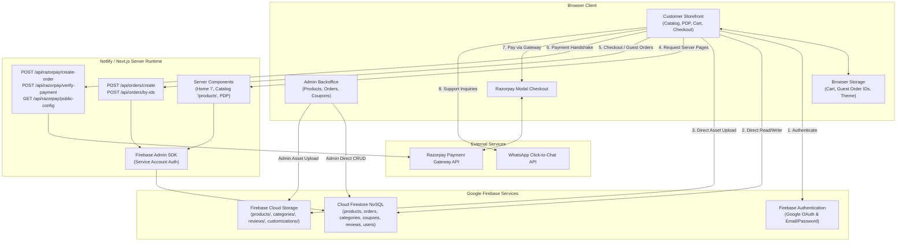

# Comprehensive Technical Architecture & Production Readiness Audit: TrendKartz

**Target Repository:** `trendzcart` (Project Name: `trendkartz`)  
**Repository Remote:** `https://github.com/Coder-MayankSaini/trendzcart.git`  
**Current Branch:** `main` | **Target Commit:** `9cd151a3f07858a2063be9c4b02477d8231b9d36`  
**Audit Date:** November 2026  
**Auditor Roles:** Principal Software Architect, Senior Full-Stack Engineer, Application Security Auditor, DevOps Reviewer  
**Classification:** Technical Due Diligence & Architecture Assessment (READ-ONLY AUDIT)

---

## 1. Executive Summary

### 1.1 Business Context and Revival Objectives
TrendKartz is an e-commerce platform designed to sell ready-to-wear apparel and customized merchandise (e.g., personalized text engraving and custom photo printing on garments and accessories). The business operated previously and was deployed using Netlify and Firebase. Following a dormant period of several months, the application was recently reconnected to a primary custom domain and its existing frontend build became publicly accessible again.

The project owner is now preparing to revive commercial operations, execute a comprehensive visual redesign, resolve existing technical deficiencies, and relaunch the platform in production.

### 1.2 Architectural Assessment Summary
The repository is built on a modern foundation: **Next.js 16 (App Router)** with **React 19**, written in **TypeScript 5**. It utilizes **Google Cloud Firestore** as its primary NoSQL document store, **Firebase Authentication** for identity management, **Firebase Cloud Storage** for asset hosting and customer photo uploads, and **Razorpay** for Indian Rupee (INR) payment processing alongside Cash on Delivery (COD).

The platform demonstrates several well-implemented core capabilities:
- Clean Next.js App Router structure with dedicated route groups for storefront `(storefront)` and administration `(admin)`.
- Client-side image compression (`browser-image-compression`) generating both high-resolution assets and lightweight thumbnails prior to Firebase Storage upload.
- Hybrid data-fetching model utilizing Server-Side Rendering (SSR) and Incremental Static Regeneration (ISR) on the homepage, combined with dynamic routing for product pages.

### 1.3 Critical Vulnerabilities & Blockers
Despite a functioning user interface, the codebase contains **critical architectural and security vulnerabilities that present immediate financial and legal risks**:
1. **Client-Driven Pricing and Order Manipulation (Financial Risk — CRITICAL):** The server-side order creation endpoint (`/api/orders/create`) and the Razorpay order creation endpoint (`/api/razorpay/create-order`) do not validate product prices, item totals, or coupon discounts against the database. Instead, they accept totals and amounts directly from client-side JSON payloads. A malicious actor can purchase any product for ₹1 or mark an order as "PAID" without financial settlement.
2. **Unauthenticated Order Creation & Data Tampering (CRITICAL):** The `/api/orders/create` endpoint lacks authentication, session binding, and authorization checks. Anyone can create or overwrite arbitrary order records in Firestore.
3. **Customer PII Harvest Risk (HIGH):** The guest order retrieval route (`/api/orders/by-ids`) accepts arbitrary arrays of order IDs and returns full customer names, phone numbers, email addresses, and physical street addresses without rate limiting or identity verification.
4. **Missing Payment Gateway Webhooks (HIGH):** Payment capture relies entirely on the client browser executing a callback function after Razorpay checkout. If a buyer closes their tab or loses internet connectivity immediately after bank debit, the payment is captured in Razorpay, but no order record is ever committed to Firestore.
5. **Privilege Escalation Risk on Admin Dashboard (HIGH):** Administrative access is guarded purely client-side via `AdminGuard.tsx` checking a `role: "admin"` property retrieved from Firestore `users/{uid}`. If Firestore security rules permit user-level writes, any registered customer can elevate their own privileges to administrator.
6. **Zero Automated Testing:** There are zero unit, integration, or end-to-end tests across the entire repository.
7. **34 Known Dependency Vulnerabilities:** A package lockfile audit reveals 34 known vulnerabilities, including 3 critical vulnerabilities in transitive dependencies (`protobufjs`, `websocket-driver`).

### 1.4 High-Level Verdict
- **Overall Relaunch Recommendation: NO-GO** for commercial payment transactions.
- **Conditional Status:** The platform may be showcased as a read-only catalog preview, but transactional checkout, live order processing, and payment capture must remain disabled until P0 security and data integrity remediations are fully implemented and verified.

---

## 2. Repository and Git Status

### 2.1 Working Tree & Metadata
- **Current Branch:** `main` (synchronized with `origin/main`).
- **Latest Commit Hash:** `9cd151a3f07858a2063be9c4b02477d8231b9d36`
- **Latest Commit Author:** Mayank Saini (`officialmail.mayanksaini@gmail.com`)
- **Latest Commit Subject:** `chore: replace favicon.ico with SVG icon file`
- **Working Tree Cleanliness:** Clean. Only one untracked local file present: `Agent.md` (containing local agent safety instructions).
- **Remote Configuration:** `origin -> https://github.com/Coder-MayankSaini/trendzcart.git` (fetch and push).

### 2.2 Commit History Analysis
The Git history consists of **29 commits** tracing an iterative transition from an initial Next.js scaffold to a custom e-commerce solution:
- `ab03262`: Initial commit from `create-next-app`.
- `d65698f` to `a565e8b`: Core e-commerce foundation added (categories CRUD, dynamic home page, admin dashboard, cart badge, order history).
- `8375171`: Hardware-accelerated client-side image compression and thumbnail generation introduced.
- `eb1f781`: Attempted fix for Netlify serverless crashes regarding `firebase-admin` (though it was mistakenly placed into `devDependencies`).
- `c01c1ba` & `c866dd0`: Netlify secret scanner suppression and moving server secrets behind runtime helper functions.
- `a689435` & `6323319`: Shifted order creation from direct Firestore client SDK to Next.js API route handlers to bypass Firestore client permission errors, and added guest order history backed by local storage.
- `e843918` to `9cd151a`: Product size selection support, review display adjustments, and SVG favicon replacement.

---

## 3. Technology Stack

| Category | Technology / Library | Version (Declared / Locked) | Operational Role & Notes |
|---|---|---|---|
| **Runtime Environment** | Node.js | Local: `v24.15.0` (Recommended: `>=20.x LTS`) | Execution runtime for Next.js serverless functions and build tools. |
| **Package Manager** | npm | `11.12.1` (Lockfile v3) | Package management via `package-lock.json` (328 KB). |
| **Core Framework** | Next.js (App Router) | `16.1.6` | App Router architecture with Server and Client Components. |
| **UI Framework** | React / React-DOM | `19.2.3` | Core UI rendering engine. |
| **Language** | TypeScript | `^5.x` | Strongly typed codebase configured in `tsconfig.json` (`strict: true`). |
| **Styling Engine** | Vanilla CSS + CSS Variables | N/A (`globals.css` - 2,710 lines) | Global stylesheet with dark/light mode CSS custom properties. |
| **Unused Tooling** | Tailwind CSS / PostCSS | `tailwindcss: ^4`, `@tailwindcss/postcss: ^4` | Configured in `postcss.config.mjs` but **never imported** in `globals.css`. |
| **Client Database / Auth** | Firebase Web SDK | `^12.9.0` | Modular v9+ SDK for Auth, Firestore, and Storage. |
| **Server Database / Auth** | Firebase Admin SDK | `^13.7.0` (in `devDependencies`) | Server-side Firestore operations in Next.js Route Handlers. |
| **Payment Gateway** | Razorpay SDK | `^2.9.6` | Payment orders creation and HMAC-SHA256 signature verification. |
| **Client Utilities** | `browser-image-compression` | `^2.0.2` | Compresses full images (1MB) and thumbnails (100KB) in browser. |
| **Identity / IDs** | `uuid` | `^13.0.0` (with `@types/uuid: ^10.0.0`) | Client-side UUID generation for cart items and orders. |
| **Linting & Code Quality** | ESLint | `^9` (`eslint-config-next: 16.1.6`) | Flat config format (`eslint.config.mjs`). |
| **Automated Testing** | None | N/A | **Zero test packages installed** (no Jest, Vitest, Cypress, or Playwright). |
| **Hosting & Deployment** | Netlify | Unversioned / Git-integrated | Deployment target configured via `netlify.toml`. |

---

## 4. Directory Structure

```text
trendzcart/
├── .git/                               # Git repository metadata
├── docs/                               # Architecture and audit documentation
│   └── REPOSITORY_AUDIT.md             # This comprehensive audit document
├── public/                             # Static public assets (SVGs)
│   ├── file.svg, globe.svg, next.svg, vercel.svg, window.svg
├── src/
│   ├── app/                            # Next.js App Router root
│   │   ├── (admin)/                    # Route Group: Administrative Backoffice
│   │   │   └── admin/
│   │   │       ├── categories/page.tsx # Category management CRUD
│   │   │       ├── coupons/page.tsx    # Coupon management CRUD & activation
│   │   │       ├── dashboard/page.tsx  # KPI metrics, revenue, recent orders
│   │   │       ├── orders/page.tsx     # Order fulfillment & status updates
│   │   │       ├── products/page.tsx   # Wrapper page for AdminProducts
│   │   │       └── layout.tsx          # Admin layout with sidebar navigation
│   │   ├── (storefront)/               # Route Group: Customer E-commerce Storefront
│   │   │   ├── about/page.tsx          # Brand story & company info
│   │   │   ├── cart/page.tsx           # Cart review, quantity edit, coupon form
│   │   │   ├── categories/page.tsx     # Category browsing page
│   │   │   ├── checkout/page.tsx       # Checkout, Razorpay flow, COD placement
│   │   │   ├── contact/page.tsx        # Customer service contact channels
│   │   │   ├── orders/page.tsx         # Order tracking (User & Guest via localStorage)
│   │   │   ├── privacy/page.tsx        # Privacy policy & data usage statements
│   │   │   ├── products/
│   │   │   │   ├── [...slug]/page.tsx  # Dynamic catch-all product detail page (PDP)
│   │   │   │   └── page.tsx            # Product catalog with category query filter
│   │   │   ├── terms/page.tsx          # Shipping, return policies, terms of service
│   │   │   ├── layout.tsx              # Storefront layout (Navbar, Footer, WhatsApp)
│   │   │   └── page.tsx                # Homepage (Hero, Marquee, Categories, Featured)
│   │   ├── api/                        # Next.js Serverless Route Handlers
│   │   │   ├── orders/
│   │   │   │   ├── by-ids/route.ts     # Batch order lookup for guests by order IDs
│   │   │   │   └── create/route.ts     # Order creation via Firebase Admin SDK
│   │   │   └── razorpay/
│   │   │       ├── create-order/route.ts # Initiates Razorpay payment order
│   │   │       ├── public-config/route.ts# Serves Razorpay Key ID to frontend
│   │   │       └── verify-payment/route.ts# Validates Razorpay HMAC signature
│   │   ├── globals.css                 # Master stylesheet (2,710 lines of vanilla CSS)
│   │   ├── icon.svg                    # Application favicon / tab icon
│   │   └── layout.tsx                  # Root layout (Fonts, Theme, Auth, Cart Providers)
│   ├── components/
│   │   ├── admin/
│   │   │   ├── AdminGuard.tsx          # Client-side role-based routing guard
│   │   │   └── AdminProducts.tsx       # Monolithic product management & fake reviews
│   │   └── storefront/
│   │       ├── AuthModal.tsx           # Authentication modal (Google, Email, Reset)
│   │       ├── Navbar.tsx              # Store navigation bar with responsive drawer
│   │       ├── ProductCustomizer.tsx   # Size selector, custom text & image upload
│   │       ├── ProductImageGallery.tsx # PDP multi-image interactive viewer
│   │       ├── ProductReviews.tsx      # Customer reviews display, verification, submit
│   │       └── WhatsAppFloat.tsx       # Floating WhatsApp click-to-chat button
│   ├── context/
│   │   ├── AuthContext.tsx             # Firebase Auth state & user profile sync
│   │   ├── CartContext.tsx             # LocalStorage cart state & calculations
│   │   └── ThemeContext.tsx            # Light/Dark mode state & DOM class toggle
│   └── lib/
│       └── firebase/
│           ├── admin.ts                # Server-only Firebase Admin initialization
│           └── config.ts               # Client-side Firebase App/Auth/Db/Storage init
├── .gitignore                          # Standard git ignore definitions
├── Agent.md                            # Untracked project engineering rules
├── cors.json                           # Google Cloud Storage CORS configuration
├── eslint.config.mjs                   # ESLint 9 flat configuration
├── netlify.toml                        # Netlify build environment overrides
├── next.config.ts                      # Next.js configuration (images, COOP header)
├── package-lock.json                   # Deterministic dependency tree
├── package.json                        # Project manifests, scripts, dependencies
├── postcss.config.mjs                  # PostCSS plugins configuration
├── README.md                           # Boilerplate Create Next App readme
└── tsconfig.json                       # TypeScript compiler options
```

---

## 5. Application Architecture and Data Flow

### 5.1 Architecture Diagram



### 5.2 Actual Data Flows

#### Flow 1: Product Discovery & Catalog Browsing
- **Homepage (`/`)**: Executes on the server as an ISR page (`revalidate = 60`). The server initializes `adminDb` and queries `categories` where `showOnHome == true` ordered by `order`, and `products` where `isFeatured == true` limit 8.
- **Product Catalog (`/products`)**: Executes on the server with `dynamic = "force-dynamic"`. Queries `products` where `isVisible == true` ordered by `createdAt` desc. If a `?category=` search parameter is provided, products are filtered **in-memory** by the Next.js server.
- **Product Details (`/products/[...slug]`)**: Dynamic catch-all route executing on the server. Looks up products by slug: `adminDb.collection("products").where("slug", "==", slug).where("isVisible", "==", true).limit(1)`. If found, renders product gallery, customizer form, and customer reviews.

#### Flow 2: Cart & Local Persistence
- Cart state is maintained purely in client-side React Context (`CartContext.tsx`) and synchronized with `localStorage.getItem("trendkartz_cart")`.
- When custom apparel items with uploaded photos are customized, the client uploads the raw image directly from the browser to Firebase Cloud Storage under `customizations/{uuid}.{ext}`. The resulting download URL is embedded into the cart item's `customizationData.pictureUrl`.
- No database cart is maintained in Firestore for registered or guest users.

#### Flow 3: Coupon Application Flow
- In `src/app/(storefront)/cart/page.tsx`, when a customer enters a coupon code, the browser directly queries Firestore client-side: `getDoc(doc(db, "coupons", code.toUpperCase()))`.
- It verifies in browser memory whether `isActive` is true, whether `expiryDate` is in the future, and whether `timesUsed < usageLimit`.
- Upon successful validation, the coupon payload `{ code, type, value }` is serialized and stored in **browser `sessionStorage`** under `trendkartz_checkout_coupon`.

#### Flow 4: Order Creation & Payment Settlement
- **Cash on Delivery (COD)**:
  1. User fills shipping address in `CheckoutPage.tsx`.
  2. Browser generates an `orderId = uuidv4()`.
  3. Browser issues a `POST /api/orders/create` with full payload: `items`, `subtotal`, `discount`, `couponDiscount`, `total`, `shippingAddress`, and `paymentMethod: "COD"`.
  4. The Next.js route handler writes the order document directly into Firestore `orders/{orderId}` using `adminDb`.
  5. The server increments `coupons/{couponCode}.timesUsed` by 1.
  6. The client records `orderId` in `localStorage.getItem("trendkartz_order_ids")` (allowing guest access) and redirects to `/orders`.
- **Razorpay Prepaid Checkout**:
  1. Client fetches Razorpay key ID from `GET /api/razorpay/public-config`.
  2. Client calls `POST /api/razorpay/create-order` passing `{ amount: finalTotal, receipt: orderId }`.
  3. Server initializes Razorpay SDK and creates an order instance on Razorpay servers (`amount * 100`).
  4. Client opens the Razorpay popup modal.
  5. On payment completion, Razorpay client callback fires. The browser sends `{ razorpay_order_id, razorpay_payment_id, razorpay_signature }` to `POST /api/razorpay/verify-payment`.
  6. Server verifies HMAC-SHA256 signature using `RAZORPAY_KEY_SECRET` and returns `{ success: true }`.
  7. **Crucial Architectural Failure:** The server does not create the order. The browser receives `{ success: true }`, and the browser then initiates a separate call to `POST /api/orders/create` with `paymentStatus: "PAID"`.
  8. If the buyer loses connection or closes the browser before step 7 completes, the payment is captured, but the order is never created in Firestore.

#### Flow 5: Order Tracking & Access Control
- For authenticated users, `MyOrdersPage.tsx` listens via Firestore client SDK: `query(collection(db, "orders"), where("userId", "==", user.uid), orderBy("createdAt", "desc"))`.
- For guest users, the browser retrieves up to 25 order IDs stored in `localStorage` and sends them via `POST /api/orders/by-ids`. The server fetches the documents via `adminDb` and returns them to the browser.

#### Flow 6: Administrative Operations
- All admin pages (`/admin/dashboard`, `/admin/products`, `/admin/categories`, `/admin/orders`, `/admin/coupons`) run as Client Components.
- When an admin updates a product, uploads a product image, modifies inventory, toggles a coupon, or updates an order status, the write operation is dispatched **directly from the client browser to Firestore and Cloud Storage using the Firebase Client SDK**, bypassing the Next.js server entirely.

---

## 6. Feature Inventory

| Feature | Implementation Status | Key Files | Backend Dependency | Verification Status | Identified Architectural & Security Risks |
|---|---|---|---|---|---|
| **Homepage & Landing** | Implemented | `src/app/(storefront)/page.tsx` | Firestore (`categories`, `products`), Cloud Storage, Unsplash | **VERIFIED** | SSR queries require compound indexes; fails silently with empty lists if Firebase Admin env is absent. |
| **Product Catalog** | Implemented | `src/app/(storefront)/products/page.tsx` | Firestore (`products`) via Admin SDK | **VERIFIED** | Dynamic query requires compound index (`isVisible` + `createdAt`). Category filtering is performed in-memory; no pagination. |
| **Product Categories** | Implemented | `src/app/(storefront)/categories/page.tsx` | Firestore (`categories`) via Client SDK | **VERIFIED** | Direct client SDK read; lack of caching; potential layout shift. |
| **Product Details (PDP)** | Implemented | `src/app/(storefront)/products/[...slug]/page.tsx` | Firestore (`products`), Cloud Storage | **VERIFIED** | Catch-all slug parsing; compound index required (`slug` + `isVisible`). |
| **Product Customizer** | Implemented | `src/components/storefront/ProductCustomizer.tsx` | Firebase Cloud Storage | **VERIFIED** | Direct client uploads to `customizations/` without server auth or file-type inspection. |
| **Product Reviews** | Implemented | `src/components/storefront/ProductReviews.tsx` | Firestore (`reviews`, `orders`), Cloud Storage | **VERIFIED** | Purchase eligibility query executed client-side. Guest purchasers cannot review products. |
| **Fake Reviews Tool** | Implemented | `src/components/admin/AdminProducts.tsx#L263-L299` | Firestore (`reviews`), Cloud Storage | **VERIFIED** | Admin UI contains form to fabricate reviews with `isFake: true`. Potential legal/consumer compliance liability. |
| **Product Search** | **Missing** | N/A | None | **VERIFIED** | No search bar, text index, or search endpoint exists in the entire application. |
| **Faceted Filtering** | **Missing** | N/A | None | **VERIFIED** | Cannot filter by price range, size, stock, tags, or rating. |
| **Authentication** | Implemented | `src/context/AuthContext.tsx`, `src/components/storefront/AuthModal.tsx` | Firebase Authentication | **VERIFIED** | Google popup requires authorized domain. User profile synced to Firestore `users/{uid}`. |
| **User Profiles** | Partially Implemented | `src/context/AuthContext.tsx` | Firestore (`users/{uid}`) | **VERIFIED** | Profile created on signup (`role: "customer"`), but no user profile management UI exists. |
| **Shopping Cart** | Implemented | `src/context/CartContext.tsx`, `src/app/(storefront)/cart/page.tsx` | Browser `localStorage` | **VERIFIED** | Total calculated on client; cart items manipulated in local storage directly affect checkout pricing. |
| **Wishlist** | **Missing** | N/A | None | **VERIFIED** | Feature not present in codebase. |
| **Checkout Workflow** | Implemented | `src/app/(storefront)/checkout/page.tsx` | Next.js API Routes, Razorpay, Firestore | **VERIFIED** | Critical pricing tampering vulnerability. No server recalculation of order totals. |
| **Payment Integration** | Partially Implemented | `src/app/api/razorpay/*`, `checkout/page.tsx` | Razorpay API | **VERIFIED** | Signature verified, but order creation is delegated back to client. Lack of webhooks creates payment drop-off risk. |
| **Order Creation** | Implemented | `src/app/api/orders/create/route.ts` | Firestore (`orders`, `coupons`) via Admin SDK | **VERIFIED** | Unauthenticated route. Arbitrary `id` accepted. No validation of price, stock, or payment status. |
| **Order Tracking** | Implemented | `src/app/(storefront)/orders/page.tsx`, `src/app/api/orders/by-ids/route.ts` | Firestore (`orders`), LocalStorage | **VERIFIED** | Guest orders accessible by ID without auth. Potential PII enumeration risk. |
| **Inventory Management** | Partially Implemented | `src/components/admin/AdminProducts.tsx` | Firestore (`products`) | **VERIFIED** | Inventory count can be entered by admin, but is **never decremented** upon checkout. Overselling is unchecked. |
| **Admin Dashboard** | Partially Implemented | `src/app/(admin)/admin/dashboard/page.tsx` | Firestore (`orders`) via Client SDK | **VERIFIED** | Metrics calculated in browser over only the latest 50 orders. Hard cap makes analytics inaccurate. |
| **Admin Products CRUD** | Implemented | `src/components/admin/AdminProducts.tsx` | Firestore (`products`), Cloud Storage | **VERIFIED** | Full CRUD, image uploads with dual compression, thumbnail generation, size specification. |
| **Admin Categories CRUD**| Implemented | `src/app/(admin)/admin/categories/page.tsx`| Firestore (`categories`), Cloud Storage | **VERIFIED** | Category management with order sorting and home-screen visibility toggle. |
| **Admin Orders CRUD** | Implemented | `src/app/(admin)/admin/orders/page.tsx` | Firestore (`orders`) via Client SDK | **VERIFIED** | Real-time status update (Processing -> Shipped -> Delivered -> Cancelled). Auto-marks COD as PAID on delivery. |
| **Admin Coupons CRUD** | Implemented | `src/app/(admin)/admin/coupons/page.tsx` | Firestore (`coupons`) via Client SDK | **VERIFIED** | Coupon creation (flat/percentage), usage limits, active status toggle. |
| **Customer Management** | **Missing** | N/A | None | **VERIFIED** | No backoffice interface to view customer accounts, contact details, or order histories. |
| **Email Notifications** | **Missing** | N/A | None | **VERIFIED** | No transactional email integration (SendGrid, Resend, Nodemailer, Postmark). No order receipts sent. |
| **Returns & Refunds** | **Missing** | N/A | None | **VERIFIED** | Static policies exist in `/terms`, but no automated return flow or Razorpay refund integration exists. |

---

## 7. Firebase and Backend Audit

### 7.1 Firebase Products Overview
- **Firebase Authentication:** Enabled. Supports Google OAuth (`GoogleAuthProvider`) and Email/Password (`createUserWithEmailAndPassword`, `signInWithEmailAndPassword`, `sendPasswordResetEmail`).
- **Cloud Firestore:** Primary database storing collections: `products`, `categories`, `orders`, `users`, `coupons`, `reviews`.
- **Firebase Cloud Storage:** Bucket storage for product images, category banners, review photos, and user customizer uploads.
- **Firebase Admin SDK:** Initialized server-side in `src/lib/firebase/admin.ts` using service account environment variables (`FIREBASE_CLIENT_EMAIL`, `FIREBASE_PRIVATE_KEY`, `FIREBASE_PROJECT_ID`).
- **Cloud Functions:** **None.** No Firebase Cloud Functions directory or references exist.
- **Firebase App Check:** **Not implemented.** Firebase APIs and Storage endpoints are unprotected from automated bot scripts or direct API abuse.

### 7.2 Security Rules Audit & Production Blind Spot
> [!CAUTION]
> **Production Security Rules Status: NOT VERIFIED from repository.**  
> The repository contains **no `firestore.rules` or `storage.rules` files**. Production security rules reside exclusively inside the Google Firebase Console.

Evidence throughout the codebase indicates recurring permissions issues:
- `src/context/AuthContext.tsx#L63`: `"AuthContext/Firestore: Could not sync user profile. Check Firebase Security Rules."`
- `src/app/(admin)/admin/dashboard/page.tsx#L39`: `"Missing Firestore Read Permissions. Please update your Firebase Security Rules to allow admins to read the 'orders' collection."`
- `src/app/(admin)/admin/orders/page.tsx#L22`: `"Failed to load orders. Please update your Firestore Security Rules to allow admin reads on the 'orders' collection."`
- `src/components/admin/AdminProducts.tsx#L73`: `"Failed to load products. Check your Firestore Security Rules."`
- Git commit `a689435`: `"Move order creation and coupon usage updates to a server-side endpoint backed by Firebase Admin so COD and guest checkouts no longer fail with Firestore client permission errors."`

If administrators relaxed Firestore rules to `allow read, write: if true;` or `allow read, write: if request.auth != null;` to resolve these errors, **any authenticated customer can overwrite products, prices, coupons, and orders directly using the Firebase Web SDK**.

### 7.3 Privilege Escalation & Role-Based Access Control
- In `src/context/AuthContext.tsx#L47-L61`, when a user signs in, the client reads `users/{uid}`. If the document does not exist, it executes:
  ```typescript
  await setDoc(userRef, {
      uid: currentUser.uid,
      email: currentUser.email || "",
      role: "customer",
      createdAt: Date.now(),
  });
  ```
- In `src/components/admin/AdminGuard.tsx#L15`, administrative authorization is verified solely by checking `profile && profile.role !== "admin"`.
- If Firestore security rules allow an authenticated user to update their own `users/{uid}` document, an attacker can dispatch `updateDoc(doc(db, "users", auth.currentUser.uid), { role: "admin" })` and instantly obtain administrative privileges across all admin routes.
- **Remediation Requirement:** Custom claims must be minted via Firebase Admin SDK (`setCustomUserClaims(uid, { admin: true })`) and verified via `request.auth.token.admin == true` in Firestore rules and server session middleware.

### 7.4 Firestore Query Inefficiencies & Missing Indexes
Several queries will throw fatal runtime exceptions unless compound indexes have been manually created in the Firebase Console:
1. `products`: `.where("isVisible", "==", true).orderBy("createdAt", "desc")` (Used in `products/page.tsx#L17-L18`).
2. `products`: `.where("slug", "==", slug).where("isVisible", "==", true)` (Used in `products/[...slug]/page.tsx#L19-L20`).
3. `categories`: `.where("showOnHome", "==", true).orderBy("order", "asc")` (Used in `page.tsx#L45-L46`).
4. `orders`: `.where("userId", "==", user.uid).orderBy("createdAt", "desc")` (Used in `orders/page.tsx#L51-L52`).
5. `orders`: `.where("userId", "==", user.uid).where("orderStatus", "==", "Delivered")` (Used in `ProductReviews.tsx#L71`).

### 7.5 Domain Migration Impact on Firebase Services
Reconnecting the website to a new or revived domain introduces specific configuration requirements:
1. **Firebase Authentication Authorized Domains:** The new domain (both apex `domain.com` and subdomain `www.domain.com`) **must be explicitly added** to the authorized domains list under `Firebase Console -> Authentication -> Settings -> Authorized Domains`. Failure to do so will cause all Google Sign-In popups and redirect operations to throw `auth/unauthorized-domain`.
2. **Cross-Origin-Opener-Policy (COOP):** `next.config.ts` correctly sets `Cross-Origin-Opener-Policy: same-origin-allow-popups` to support Google OAuth popups.
3. **Cloud Storage CORS Configuration:** The root file `cors.json` permits `origin: ["*"]` for all HTTP methods. This configuration must be verified as active on the Google Cloud Storage bucket (`gsutil cors set cors.json gs://<bucket-name>`) to prevent cross-origin upload blocks on custom photos.

---

## 8. Netlify and Deployment Assessment

### 8.1 Netlify Configuration Analysis
The repository configuration for Netlify is minimal:
```toml
# netlify.toml
[build.environment]
  SECRETS_SCAN_OMIT_KEYS = "NEXT_PUBLIC_FIREBASE_API_KEY,NEXT_PUBLIC_FIREBASE_AUTH_DOMAIN,NEXT_PUBLIC_FIREBASE_PROJECT_ID,NEXT_PUBLIC_FIREBASE_STORAGE_BUCKET,NEXT_PUBLIC_FIREBASE_MESSAGING_SENDER_ID,NEXT_PUBLIC_FIREBASE_APP_ID"
```
- **Build Command:** Omitted from `netlify.toml` (relies on `npm run build` inferred from `package.json`).
- **Publish Directory:** Omitted from `netlify.toml`.
- **Netlify Next.js Plugin:** Neither `@netlify/plugin-nextjs` nor `@opennextjs/cloudflare` is declared in `netlify.toml` or `package.json`. Modern Netlify deployments infer Next.js App Router requirements via automatic framework detection, but explicit configuration is safer for enterprise stability.
- **Node.js Runtime Version:** No `.nvmrc` or `NODE_VERSION` environment variable is defined in the repository. Netlify defaults to its platform default unless specified.

### 8.2 Serverless Function Packaging Risk: `firebase-admin` in `devDependencies`
In `package.json#L29`, `firebase-admin` is declared under `"devDependencies"`:
```json
"devDependencies": {
  "firebase-admin": "^13.7.0",
  ...
}
```
Commit `eb1f781` attempted to resolve Netlify serverless crashes, but the package was never placed in production `"dependencies"`.
- **Technical Risk:** If Netlify executes `npm prune --production` or standard production bundle isolation during serverless function compilation, `firebase-admin` and its native gRPC dependencies may not be bundled into the serverless runtime.
- **Impact:** Dynamic SSR routes (`/`, `/products`, `/products/[...slug]`) and API routes (`/api/orders/create`, `/api/orders/by-ids`) may crash with `MODULE_NOT_FOUND` in production.

### 8.3 Environment Variables Audit
The application relies on 11 distinct environment variables:

| Variable Name | Exposure Scope | Purpose | Risk if Absent |
|---|---|---|---|
| `NEXT_PUBLIC_FIREBASE_API_KEY` | Public (Client) | Firebase Web SDK configuration | Frontend Firebase Auth & Firestore crash |
| `NEXT_PUBLIC_FIREBASE_AUTH_DOMAIN` | Public (Client) | Firebase Auth domain handler | Authentication fails |
| `NEXT_PUBLIC_FIREBASE_PROJECT_ID` | Public (Client) | Firebase GCP Project ID | Client & Server SDK fallback fails |
| `NEXT_PUBLIC_FIREBASE_STORAGE_BUCKET` | Public (Client) | Google Cloud Storage bucket name | Image uploads and gallery display fail |
| `NEXT_PUBLIC_FIREBASE_MESSAGING_SENDER_ID` | Public (Client) | Firebase Messaging ID | Client initialization warning |
| `NEXT_PUBLIC_FIREBASE_APP_ID` | Public (Client) | Firebase App registration ID | Client initialization warning |
| `NEXT_PUBLIC_RAZORPAY_KEY_ID` | Public (Client/API)| Razorpay Public Key ID fallback | Razorpay checkout initialization fails |
| `FIREBASE_PROJECT_ID` | Private (Server) | Service Account Project ID | Serverless API routes fail |
| `FIREBASE_CLIENT_EMAIL` | Private (Server) | Service Account Client Email | Admin SDK initialization error |
| `FIREBASE_PRIVATE_KEY` | Private (Server) | Service Account RSA Private Key | Admin SDK initialization error |
| `RAZORPAY_KEY_ID` | Private (Server) | Razorpay Merchant Key ID | Payment creation endpoint fails (500) |
| `RAZORPAY_KEY_SECRET` | Private (Server) | Razorpay Secret for HMAC verification | Payment verification endpoint fails (500) |

> [!NOTE]
> No raw values for these environment variables were discovered in tracked git files or committed `.env` files. Secret omission in `netlify.toml` prevents Netlify false-positive build failures.

---

## 9. Security and Dependency Findings

### 9.1 Static Security Review Findings

```
┌──────────────┬─────────────────────────────────────────────────────────────┐
│ CRITICAL     │ Client-Controlled Pricing, Totals, and Payment Status       │
├──────────────┼─────────────────────────────────────────────────────────────┤
│ Location     │ src/app/api/orders/create/route.ts#L35-L58                  │
│              │ src/app/api/razorpay/create-order/route.ts#L19-L38          │
│              │ src/app/(storefront)/checkout/page.tsx#L81-L128             │
├──────────────┼─────────────────────────────────────────────────────────────┤
│ Evidence     │ In route.ts:                                                │
│              │ const body = (await req.json()) as CreateOrderBody;         │
│              │ await orderRef.set({                                        │
│              │   subtotal: body.subtotal,                                  │
│              │   discount: body.discount,                                  │
│              │   couponDiscount: body.couponDiscount,                      │
│              │   total: body.total,                                        │
│              │   paymentStatus: body.paymentStatus,                        │
│              │   ...                                                       │
│              │ });                                                         │
│              │ In create-order/route.ts:                                   │
│              │ const { amount, receipt } = await req.json();               │
│              │ const options = { amount: amount * 100, ... };              │
├──────────────┼─────────────────────────────────────────────────────────────┤
│ Impact       │ An attacker can craft a POST request with total: 1 and      │
│              │ paymentStatus: "PAID" or pay ₹1 via Razorpay for items      │
│              │ worth thousands of rupees.                                  │
├──────────────┼─────────────────────────────────────────────────────────────┤
│ Remediation  │ Recompute subtotal, discounts, and final total server-side  │
│              │ by querying product prices directly from Firestore.         │
│              │ Verify Razorpay payment captured status server-side before  │
│              │ persisting order status as "PAID".                          │
└──────────────┴─────────────────────────────────────────────────────────────┘
```

```
┌──────────────┬─────────────────────────────────────────────────────────────┐
│ CRITICAL     │ Unauthenticated Order Document Overwrite                    │
├──────────────┼─────────────────────────────────────────────────────────────┤
│ Location     │ src/app/api/orders/create/route.ts#L41-L42                  │
├──────────────┼─────────────────────────────────────────────────────────────┤
│ Evidence     │ const orderRef = adminDb.collection("orders").doc(body.id); │
│              │ await orderRef.set({ ... });                                │
├──────────────┼─────────────────────────────────────────────────────────────┤
│ Impact       │ An unauthenticated attacker can submit any existing order ID│
│              │ and overwrite its customer shipping address, order items,   │
│              │ and status.                                                 │
├──────────────┼─────────────────────────────────────────────────────────────┤
│ Remediation  │ Auto-generate order IDs server-side using                   │
│              │ adminDb.collection("orders").doc(). Enforce user auth       │
│              │ token validation for authenticated checkouts.               │
└──────────────┴─────────────────────────────────────────────────────────────┘
```

```
┌──────────────┬─────────────────────────────────────────────────────────────┐
│ HIGH         │ PII Enumeration & Data Scraping via Order Lookup            │
├──────────────┼─────────────────────────────────────────────────────────────┤
│ Location     │ src/app/api/orders/by-ids/route.ts#L22-L45                  │
├──────────────┼─────────────────────────────────────────────────────────────┤
│ Evidence     │ const body = await req.json();                              │
│              │ const ids = body.ids.slice(0, 25);                          │
│              │ const snapshots = await Promise.all(ids.map(id => ...));    │
│              │ return NextResponse.json({ orders });                       │
├──────────────┼─────────────────────────────────────────────────────────────┤
│ Impact       │ Full shipping addresses (names, physical street addresses,  │
│              │ phone numbers, emails) can be harvested without             │
│              │ authentication or rate limits.                              │
├──────────────┼─────────────────────────────────────────────────────────────┤
│ Remediation  │ Restrict guest order lookup to require both orderId AND     │
│              │ matching customer phone number or email. Implement IP-based │
│              │ rate limiting.                                              │
└──────────────┴─────────────────────────────────────────────────────────────┘
```

```
┌──────────────┬─────────────────────────────────────────────────────────────┐
│ HIGH         │ Administrative Privilege Escalation via Client Firestore    │
├──────────────┼─────────────────────────────────────────────────────────────┤
│ Location     │ src/context/AuthContext.tsx#L47-L71                         │
│              │ src/components/admin/AdminGuard.tsx#L15-L21                 │
├──────────────┼─────────────────────────────────────────────────────────────┤
│ Evidence     │ Admin status is determined purely by reading Firestore doc  │
│              │ users/{uid} role field and evaluated on the client.         │
├──────────────┼─────────────────────────────────────────────────────────────┤
│ Impact       │ If Firestore rules allow users to update their own record,   │
│              │ any user can set role: "admin" and gain full admin access.  │
├──────────────┼─────────────────────────────────────────────────────────────┤
│ Remediation  │ Migrate administrative authorization to Firebase Auth       │
│              │ Custom Claims, verified server-side.                        │
└──────────────┴─────────────────────────────────────────────────────────────┘
```

```
┌──────────────┬─────────────────────────────────────────────────────────────┐
│ HIGH         │ Payment Drop-Off & Revenue Loss via Missing Webhooks        │
├──────────────┼─────────────────────────────────────────────────────────────┤
│ Location     │ src/app/(storefront)/checkout/page.tsx#L182-L205            │
├──────────────┼─────────────────────────────────────────────────────────────┤
│ Evidence     │ Razorpay modal handler executes saveOrder() in browser      │
│              │ after verify-payment returns. No Razorpay webhook endpoint  │
│              │ exists in src/app/api/.                                     │
├──────────────┼─────────────────────────────────────────────────────────────┤
│ Impact       │ Customers charged by Razorpay who navigate away or suffer   │
│              │ network disconnects will never have their order recorded.   │
├──────────────┼─────────────────────────────────────────────────────────────┤
│ Remediation  │ Implement a server-to-server Razorpay Webhook endpoint      │
│              │ (/api/webhooks/razorpay) to handle order.paid events.       │
└──────────────┴─────────────────────────────────────────────────────────────┘
```

```
┌──────────────┬─────────────────────────────────────────────────────────────┐
│ MEDIUM       │ Unchecked File Uploads directly to Cloud Storage            │
├──────────────┼─────────────────────────────────────────────────────────────┤
│ Location     │ src/components/storefront/ProductCustomizer.tsx#L51-L69     │
│              │ cors.json#L3-L5                                             │
├──────────────┼─────────────────────────────────────────────────────────────┤
│ Evidence     │ Client directly uploads to customizations/${uuid}.${ext}.   │
│              │ cors.json permits origin: ["*"] with all HTTP verbs.        │
├──────────────┼─────────────────────────────────────────────────────────────┤
│ Impact       │ Unauthenticated clients can exhaust Storage quotas or upload│
│              │ arbitrary file types without validation.                    │
├──────────────┼─────────────────────────────────────────────────────────────┤
│ Remediation  │ Restrict allowed MIME types and file sizes in Cloud Storage │
│              │ security rules; generate presigned upload URLs server-side. │
└──────────────┴─────────────────────────────────────────────────────────────┘
```

### 9.2 Dependency Audit Results
Execution of safe, read-only dependency inspection (`npm audit --package-lock-only`) revealed **34 vulnerabilities (2 low, 12 moderate, 17 high, 3 critical)**:

```text
# Exact Command Executed:
npm audit --package-lock-only
# Exit Code: 1 (Vulnerabilities Detected)

Summary:
- Total Vulnerabilities: 34
- Critical Severity: 3
- High Severity: 17
- Moderate Severity: 12
- Low Severity: 2

Key Vulnerabilities Identified:
1. protobufjs (<=7.6.4): CRITICAL
   - Code injection through bytes field defaults (GHSA-66ff-xgx4-vchm)
   - Denial of service from crafted field names (GHSA-2pr8-phx7-x9h3)
   - Prototype injection in message constructors (GHSA-fx83-v9x8-x52w)
   - Introduced via firebase-admin -> @google-cloud/firestore -> google-gax.
2. websocket-driver (<=0.7.4): CRITICAL
   - Resource limit bypass via message compression (GHSA-mp7j-qc5w-4988)
   - Message corruption via protocol length headers (GHSA-xv26-6w52-cph6)
3. axios (1.0.0 - 1.19.0): HIGH
   - Multiple SSRF bypasses via NO_PROXY normalization (GHSA-3p68-rc4w-qgx5)
   - Prototype pollution leading to header injection and credential leakage.
4. sharp (<=0.35.5-rc.1): HIGH
   - Vulnerabilities in underlying libvips, libheif, and librsvg.
5. @grpc/grpc-js (<=1.13.5 || 1.14.0 - 1.14.4): HIGH
   - Malformed request server crash & certificate validation errors.
6. zod (<4.6.6): HIGH
   - Memory exhaustion DoS via oversized constrained collections.
```

---

## 10. Code Quality and Maintainability

### 10.1 Modular Structure vs. Monolithic Components
- **`AdminProducts.tsx` (630 lines):** Combines category fetching, product CRUD state, multi-file image selection, canvas preview generation, hardware image compression, Firebase Storage uploads, Firestore writes, and a fake review generator into a single file.
- **`globals.css` (2,710 lines):** Monolithic stylesheet containing global variables, layout rules, component styles, media queries, and legacy animations. Tailwind CSS was installed as a dependency but never imported, leaving redundant build tooling in place.
- **`CheckoutPage.tsx` (401 lines):** Combines shipping address forms, coupon state, Razorpay script injection, Razorpay modal handling, and order creation API calls in one component.

### 10.2 Code Duplication & Hardcoded Configuration
1. **Support Phone Number:** The string `"918278377255"` is hardcoded separately in `src/components/storefront/WhatsAppFloat.tsx#L4` and `src/app/(storefront)/contact/page.tsx#L10`.
2. **Support Email:** The string `"ofctrendkartz@gmail.com"` is hardcoded separately in `src/app/(storefront)/layout.tsx#L47` and `src/app/(storefront)/contact/page.tsx#L35`.
3. **Image Compression Logic:** Client-side image compression configurations using `imageCompression()` are duplicated across `AdminProducts.tsx`, `AdminCategories.tsx`, and `ProductReviews.tsx`.
4. **Dead Code:** `src/app/(storefront)/page.tsx#L16-L21` defines a `features` array that is completely unused in the rendered JSX.

### 10.3 Type Safety & TypeScript Strictness
- `tsconfig.json` correctly activates `"strict": true`.
- However, throughout the codebase, type safety is frequently bypassed using `any`:
  - `items: any[]` in `CreateOrderBody` (`api/orders/create/route.ts#L8`).
  - `order: any` and `item: any` in `AdminOrders.tsx` and `orders/page.tsx`.
  - `auth as any`, `db as any`, `storage as any` in `src/lib/firebase/config.ts#L26-L28`.
  - Multiple disconnected type definitions for `Product` across `AdminProducts.tsx`, `page.tsx`, and `ProductCustomizer.tsx`.

### 10.4 Execution Verification Log
As required by safety constraints, all local command attempts and their outcomes are recorded:

| Exact Command Executed | Result Status | Output / Error Summary | Limitations / Notes |
|---|---|---|---|
| `git status` | Passed (Code 0) | Working tree clean, branch `main`, untracked `Agent.md`. | Verified clean repository status. |
| `git log -n 5 --stat` | Passed (Code 0) | Commits inspectable. | Verified recent development trajectory. |
| `node -v; npm -v` | Passed (Code 0) | Node `v24.15.0`, npm `11.12.1`. | Host runtime verified. |
| `Test-Path node_modules` | Passed (Code 0) | Returned `False`. | `node_modules` is not present locally. |
| `npm audit --package-lock-only`| Failed (Code 1) | 34 vulnerabilities reported (3 critical, 17 high). | Read-only scan on lockfile. No files modified. |
| `eslint -v` | Failed (Code 1) | `eslint : The term 'eslint' is not recognized...` | ESLint not installed globally. |
| `npm run lint` | **SKIPPED** | Skipped because `node_modules` is not installed. | Running requires `npm install`, which violates safety rule #3. |
| `npm run build` | **SKIPPED** | Skipped because dependencies are not installed. | Cannot execute Next build without local packages. |
| `npm test` | **SKIPPED** | Skipped because no test runner or script is configured. | No test harness defined in `package.json`. |

---

## 11. UI/UX, Accessibility, and Performance Assessment

### 11.1 Visual Presentation & Redesign Opportunities
- **Current Aesthetic:** Clean minimalist modern style using Inter typography, subtle borders, and smooth transitions.
- **Redesign Opportunities:**
  - Modernize product cards with hover micro-interactions, secondary image preview on hover, and quick-add actions.
  - Replace rudimentary HTML tables in the Admin Backoffice (`AdminOrders.tsx`, `AdminDashboard.tsx`) with modern data grids featuring pagination, column filtering, and responsive card layouts for mobile administrators.
  - Upgrade the Cart and Checkout interfaces from basic stacked input fields to a streamlined accordion checkout with real-time address validation.

### 11.2 Usability & Customer Journey Deficiencies
1. **Absence of Product Search:** Customers cannot search by keyword, title, or SKU.
2. **Missing Catalog Sorting:** Customers cannot sort catalog products by Price (Low to High / High to Low), Popularity, or Newest.
3. **Disruptive Browser Alerts:** The checkout, cart, and admin flows heavily rely on native browser `alert()` popups (`alert("Failed to place order.")`, `alert("Please fill in all required shipping details...")`). These disrupt mobile users and should be replaced with accessible toast notifications.
4. **Guest Order Access Barrier:** Guest users cannot look up past orders from the main navigation; the navbar only exposes the "My Orders" link to logged-in users.

### 11.3 Accessibility (a11y) Evaluation
- **Form Inputs:** Several inputs rely on placeholder text rather than explicitly associated `<label htmlFor="...">` bindings.
- **Modals:** `AuthModal.tsx` lacks focus trapping, `aria-modal="true"`, and `role="dialog"`, creating keyboard navigation traps for screen reader users.
- **Image Alternates:** Several dynamic product thumbnails fallback to empty alt attributes or lack descriptive alternative text.

### 11.4 Performance & Asset Optimization
- **Image Delivery Inconsistency:** While the Homepage (`src/app/(storefront)/page.tsx`) utilizes `next/image` with responsive `sizes` and modern formats, the Product Catalog (`products/page.tsx`), Product Details (`[...slug]/page.tsx`), and Shopping Cart (`cart/page.tsx`) use raw standard `` tags. This bypasses Next.js automatic WebP/AVIF transcoding and responsive device downsizing.
- **Client Compression Pipeline (Strength):** `AdminProducts.tsx` compresses uploaded product photos to `<1MB` (max 1920px) and creates thumbnails `<100KB` (max 600px) using `browser-image-compression` before uploading to Cloud Storage. This prevents storage bloat.

---

## 12. Testing and Observability

### 12.1 Current Testing State
- **Unit Tests:** None present.
- **Integration Tests:** None present.
- **End-to-End Tests:** None present.
- **Security Rule Tests:** No `@firebase/rules-unit-testing` suites exist.
- **CI/CD Quality Gates:** No GitHub Actions workflows exist under `.github/workflows`. Changes pushed to `main` deploy directly to Netlify without automated test verification.

### 12.2 Observability & Error Visibility
- **Error Tracking:** No production application monitoring (e.g., Sentry, LogRocket, Datadog) is integrated.
- **Server Logging:** Next.js route handlers rely purely on standard `console.error()`. In Netlify serverless functions, these logs are ephemeral and difficult to aggregate without external APM tooling.
- **Payment Auditing:** No persistent audit log tracks failed payment verifications or signature discrepancies.

### 12.3 Recommended Minimal Testing Strategy
Prior to production relaunch, the following minimal testing harness should be established:
1. **Unit Tests (Vitest):**
   - Cart calculations: item subtotals, flat coupons, percentage coupons, tax inclusive rules.
   - Razorpay HMAC signature validation utility.
2. **API Integration Tests:**
   - Server-side price recalculation in `/api/orders/create`.
   - Idempotency and order validation tests.
3. **End-to-End Tests (Playwright):**
   - Critical path: Homepage -> Catalog -> Product Details -> Customization -> Cart -> Checkout (COD flow).
   - Admin authentication guard verification.

---

## 13. Production Readiness Matrix

| Operational Dimension | Status | Justification & Architectural Evidence |
|---|---|---|
| **1. Functional Completeness** | **NEEDS WORK** | Core storefront and admin exist, but Search, Sorting, Wishlist, Transactional Emails, and Return flows are absent. |
| **2. Security Readiness** | **BLOCKED** | Critical vulnerabilities: client-controlled pricing, unauthenticated order creation, and PII harvesting risk. |
| **3. Dependency Health** | **NEEDS WORK** | 34 vulnerabilities in package lockfile (3 critical, 17 high). `firebase-admin` miscategorized in `devDependencies`. |
| **4. Architecture Maintainability** | **NEEDS WORK** | Monolithic components (630-line `AdminProducts.tsx`, 2,710-line CSS), duplicated constants, unused Tailwind configuration. |
| **5. Deployment Reproducibility** | **NEEDS WORK** | `netlify.toml` lacks explicit build command and publish directory. No Node version pinning via `.nvmrc`. |
| **6. Firebase Configuration Safety** | **BLOCKED / NOT VERIFIED** | Security rules missing from repository; code comments reveal recurring permission failures. New domain auth unverified. |
| **7. Payment & Order Reliability**| **BLOCKED** | Lack of Razorpay Webhook creates payment drop-off risk where charged customers receive no order confirmation. |
| **8. Testing Maturity** | **BLOCKED** | Zero automated tests (unit, integration, or E2E) and no CI pipeline gates. |
| **9. Error Visibility** | **NEEDS WORK** | No crash reporting or telemetry (Sentry). Only transient `console.error` logs in serverless runtime. |
| **10. Performance** | **NEEDS WORK** | Inconsistent `next/image` adoption outside homepage; missing compound indexes on key Firestore queries. |
| **11. Rollback Preparedness** | **READY** | Netlify git integration provides instant atomic rollbacks to previous successful deploy hashes. |

---

## 14. Prioritized Technical Debt and Risk Register

| Risk ID | Severity | Category | Description | Business & Technical Impact | Suggested Remediation |
|---|---|---|---|---|---|
| **RSK-01** | **CRITICAL** | Security / Finance | Client-side order amount and price manipulation in checkout. | Attackers can order high-value items for ₹1 or mark orders as PAID. | Recalculate all totals server-side in `/api/orders/create` from Firestore product prices. |
| **RSK-02** | **CRITICAL** | Security / Integrity | Unauthenticated `/api/orders/create` allows order overwrite. | Disruption of fulfillment; malicious overwriting of legitimate orders. | Generate order IDs server-side; authenticate users; validate order uniqueness. |
| **RSK-03** | **HIGH** | Security / Privacy | Guest order lookup `/api/orders/by-ids` exposes customer PII. | Scraping of customer delivery addresses, phone numbers, and emails. | Require order ID + phone/email verification; enforce strict rate limits. |
| **RSK-04** | **HIGH** | Security / Auth | Role escalation via Firestore `users/{uid}` document update. | Customers can elevate their role to `admin` and access store management. | Use Firebase Auth Custom Claims (`admin: true`) verified server-side. |
| **RSK-05** | **HIGH** | Reliability / Payment | Absence of Razorpay Webhook for server-side payment capture. | Customer charged by gateway, but order never saved if browser closes early. | Build `/api/webhooks/razorpay` to process `order.paid` events server-to-server. |
| **RSK-06** | **HIGH** | Inventory | Inventory is never checked or decremented on order placement. | Overselling out-of-stock items, resulting in customer disputes and refunds. | Implement atomic inventory decrement in Firestore transaction during order save. |
| **RSK-07** | **HIGH** | Dependencies | 34 vulnerabilities including 3 critical in `protobufjs` and `websocket-driver`. | Remote code execution, prototype pollution, and denial of service. | Safely update vulnerable subdependencies via targeted npm upgrades. |
| **RSK-08** | **MEDIUM** | Deployment | `firebase-admin` declared in `devDependencies`. | Serverless functions in Netlify can crash with `MODULE_NOT_FOUND`. | Move `firebase-admin` to production `dependencies` in `package.json`. |
| **RSK-09** | **MEDIUM** | Compliance | Admin fake reviews tool generates synthetic customer reviews. | Regulatory violations (e.g. consumer protection rules against fake reviews). | Deprecate fake review generator; enforce verified purchase checks. |
| **RSK-10** | **MEDIUM** | UX / Architecture | Missing transactional order confirmation emails. | Customer anxiety post-purchase, leading to redundant support inquiries. | Integrate Resend or SendGrid to dispatch automated order confirmation emails. |
| **RSK-11** | **LOW** | Code Quality | Tailwind CSS declared but unimported; 2,710 lines of vanilla CSS. | Confusing developer tooling; redundant build configuration. | Either complete Tailwind v4 adoption or remove `@tailwindcss/postcss`. |

---

## 15. Recommended Relaunch Roadmap

### P0 — Critical (Must be Completed Before Accepting Real Payments)
- [ ] **Task 0.1: Server-Side Price & Total Calculation**
  - *Problem:* Client sends `total`, `discount`, and `subtotal` directly.
  - *Solution:* In `/api/orders/create`, fetch each item by `id` from Firestore `products` collection, recalculate total with active coupons, and reject mismatches.
  - *Complexity:* Medium | *Files:* `src/app/api/orders/create/route.ts`, `src/app/(storefront)/checkout/page.tsx`
- [ ] **Task 0.2: Secure Razorpay Integration with Server Webhooks**
  - *Problem:* Order creation occurs in client browser handler; payment total is unverified.
  - *Solution:* Pass item IDs to `/api/razorpay/create-order` so the server calculates paise amount. Implement `/api/webhooks/razorpay` to listen for `payment.captured` / `order.paid` and write order to Firestore server-to-server.
  - *Complexity:* Large | *Files:* `src/app/api/razorpay/create-order/route.ts`, new `src/app/api/webhooks/razorpay/route.ts`
- [ ] **Task 0.3: Secure Order Creation & Guest Lookup Boundaries**
  - *Problem:* Unauthenticated document overwrite in `/api/orders/create`; PII exposure in `/api/orders/by-ids`.
  - *Solution:* Auto-generate Firestore document IDs server-side. In `by-ids`, require verification of customer phone or email alongside order ID.
  - *Complexity:* Medium | *Files:* `src/app/api/orders/create/route.ts`, `src/app/api/orders/by-ids/route.ts`
- [ ] **Task 0.4: Firebase Production Security Rules & Custom Claims**
  - *Problem:* Rules not stored in repo; potential full read/write exposure; client-side role check.
  - *Solution:* Author and version `firestore.rules` and `storage.rules` in repo. Assign admin role via Firebase Admin Custom Claims (`admin: true`).
  - *Complexity:* Medium | *Files:* new `firestore.rules`, new `storage.rules`, `src/context/AuthContext.tsx`
- [ ] **Task 0.5: Dependency Packaging Fix**
  - *Problem:* `firebase-admin` in `devDependencies` risks runtime serverless failures.
  - *Solution:* Move `firebase-admin` to `dependencies` in `package.json`.
  - *Complexity:* Small | *Files:* `package.json`, `package-lock.json`

### P1 — High (Essential for Reliable Commercial Operations)
- [ ] **Task 1.1: Atomic Inventory Decrements & Stock Check**
  - *Problem:* Products with 0 inventory can be purchased; stock counts never decrement.
  - *Solution:* In order creation, run a Firestore transaction checking `inventory >= quantity` and execute `inventory: FieldValue.increment(-quantity)`.
  - *Complexity:* Medium | *Files:* `src/app/api/orders/create/route.ts`
- [ ] **Task 1.2: Transactional Email Integration**
  - *Problem:* Customers receive no confirmation email upon order placement.
  - *Solution:* Integrate Resend or SendGrid in order creation flow to send customer receipts and admin notifications.
  - *Complexity:* Medium | *Files:* new `src/lib/email.ts`, `src/app/api/orders/create/route.ts`
- [ ] **Task 1.3: Resolve Critical & High Dependency Vulnerabilities**
  - *Problem:* 34 vulnerabilities in npm lockfile.
  - *Solution:* Run non-breaking security updates for `protobufjs`, `axios`, `sharp`, `websocket-driver`.
  - *Complexity:* Medium | *Files:* `package.json`, `package-lock.json`
- [ ] **Task 1.4: Firebase Auth Domain & Storage CORS Verification**
  - *Problem:* Revived domain may trigger `auth/unauthorized-domain` or CORS blocks on custom photo uploads.
  - *Solution:* Authorize revived domain in Firebase Console; apply `cors.json` to GCP storage bucket.
  - *Complexity:* Small | *Files:* Firebase Console configuration

### P2 — Medium (Visual Redesign & Maintainability Improvements)
- [ ] **Task 2.1: Storefront Search & Sorting**
  - *Problem:* No keyword search or price sorting across products.
  - *Solution:* Implement text search input in Navbar and category pages with sorting options (Price, Date).
  - *Complexity:* Medium | *Files:* `src/components/storefront/Navbar.tsx`, `src/app/(storefront)/products/page.tsx`
- [ ] **Task 2.2: Visual Redesign & Component Polish**
  - *Problem:* Basic UI styling; native `alert()` dialogs; raw `` tags on catalog and PDP.
  - *Solution:* Modernize product cards, migrate images to `next/image`, replace `alert()` with modern toast notifications (e.g. Sonner).
  - *Complexity:* Large | *Files:* `globals.css`, `Navbar.tsx`, `ProductCustomizer.tsx`, `cart/page.tsx`, `checkout/page.tsx`
- [ ] **Task 2.3: Admin Backoffice Modernization**
  - *Problem:* Monolithic `AdminProducts.tsx`; dashboard metrics capped at 50 orders.
  - *Solution:* Modularize components; use Firestore count aggregation queries (`count()`) for dashboard stats.
  - *Complexity:* Medium | *Files:* `src/app/(admin)/admin/dashboard/page.tsx`, `src/components/admin/AdminProducts.tsx`

### P3 — Low (Long-Term Architectural Clean-Up)
- [ ] **Task 3.1: CSS Architecture Unification**
  - *Problem:* Tailwind 4 declared but unimported; 2,710 lines of vanilla CSS.
  - *Solution:* Standardize on either full Tailwind utility classes or cleanly structured CSS Modules.
  - *Complexity:* Medium | *Files:* `globals.css`, `postcss.config.mjs`
- [ ] **Task 3.2: Automated E2E Testing Suite**
  - *Problem:* No automated regression testing.
  - *Solution:* Introduce Playwright suite covering browsing, cart, and checkout user journeys.
  - *Complexity:* Medium | *Files:* new `e2e/` test specs

---

## 16. Known Unknowns and Required External Access

The following configuration parameters and production assets cannot be audited from repository source code alone and require owner verification or external console access:

1. **Firebase Console Access:**
   - **Production Security Rules:** Live `firestore.rules` and `storage.rules` must be extracted from the Firebase Console to verify current permissions.
   - **Authorized Domains:** Verification that the revived domain is listed under `Firebase Console -> Authentication -> Settings -> Authorized Domains`.
   - **Compound Indexes:** Verification that composite indexes exist for `products` (`isVisible` + `createdAt`) and `orders` (`userId` + `createdAt`).
2. **Netlify Dashboard Access:**
   - **Environment Variables:** Verification that all 11 required variables (`FIREBASE_PRIVATE_KEY`, `RAZORPAY_KEY_SECRET`, etc.) are configured in the Netlify site settings.
   - **Build Logs & Deploy Previews:** Inspection of recent production build logs to confirm serverless function compilation status.
   - **Domain DNS & SSL:** Verification of DNS records and automated Let's Encrypt SSL certificate provisioning.
3. **Razorpay Dashboard Access:**
   - **Key Mode:** Verification of whether the configured `RAZORPAY_KEY_ID` is in **Test Mode** (`rzp_test_...`) or **Live Mode** (`rzp_live_...`).
   - **Webhooks:** Inspection of configured webhook URLs and secret signatures.
   - **Auto-Capture Settings:** Verification of payment auto-capture configurations.

---

## 17. Critical Files for Architect Review

For a senior architect or security lead conducting an expedited technical review, the following files represent the core architectural boundaries and highest-risk areas:

1. [src/app/api/orders/create/route.ts](file:///C:/Users/Mayank%20Saini/Desktop/DeepuWebsite/trendzcart/src/app/api/orders/create/route.ts#L29-L72): Unauthenticated order creation, client-supplied price and status persistence.
2. [src/app/api/razorpay/create-order/route.ts](file:///C:/Users/Mayank%20Saini/Desktop/DeepuWebsite/trendzcart/src/app/api/razorpay/create-order/route.ts#L6-L42): Razorpay order initiation accepting client amount without validation.
3. [src/app/api/razorpay/verify-payment/route.ts](file:///C:/Users/Mayank%20Saini/Desktop/DeepuWebsite/trendzcart/src/app/api/razorpay/verify-payment/route.ts#L6-L29): Payment signature verification detached from order persistence.
4. [src/app/api/orders/by-ids/route.ts](file:///C:/Users/Mayank%20Saini/Desktop/DeepuWebsite/trendzcart/src/app/api/orders/by-ids/route.ts#L15-L50): Unauthenticated guest order lookup and customer PII exposure.
5. [src/app/(storefront)/checkout/page.tsx](file:///C:/Users/Mayank%20Saini/Desktop/DeepuWebsite/trendzcart/src/app/(storefront)/checkout/page.tsx#L81-L226): Client-side coupon calculation, Razorpay modal handling, and post-payment order saving.
6. [src/context/AuthContext.tsx](file:///C:/Users/Mayank%20Saini/Desktop/DeepuWebsite/trendzcart/src/context/AuthContext.tsx#L41-L79): Client-side user profile creation and role assignment.
7. [src/components/admin/AdminGuard.tsx](file:///C:/Users/Mayank%20Saini/Desktop/DeepuWebsite/trendzcart/src/components/admin/AdminGuard.tsx#L7-L31): Client-side role-based routing protection.
8. [src/components/admin/AdminProducts.tsx](file:///C:/Users/Mayank%20Saini/Desktop/DeepuWebsite/trendzcart/src/components/admin/AdminProducts.tsx#L164-L299): Product persistence, image upload pipeline, and fake review creation.
9. [src/lib/firebase/admin.ts](file:///C:/Users/Mayank%20Saini/Desktop/DeepuWebsite/trendzcart/src/lib/firebase/admin.ts#L1-L28): Server-only Firebase Admin initialization.
10. [package.json](file:///C:/Users/Mayank%20Saini/Desktop/DeepuWebsite/trendzcart/package.json#L11-L32): Dependency declarations, including `firebase-admin` in `devDependencies`.

---

## Concluding Synthesis

### Top 5 Immediate Risks
1. **Financial Arbitrage via Client Price Tampering:** Malicious users can modify order totals or coupon discounts in client payloads and purchase items for ₹1.
2. **Payment Drop-Off Without Order Creation:** The lack of Razorpay webhooks means buyers charged during network dropouts will have funds deducted without an order being created.
3. **Customer PII Exposure via Order Lookup:** The unauthenticated `/api/orders/by-ids` endpoint allows arbitrary retrieval of customer delivery names, phone numbers, and street addresses.
4. **Privilege Escalation to Admin:** Reliance on client-side Firestore document reads (`role: "admin"`) enables potential administrative takeover if Firestore rules permit user-level writes.
5. **Runtime Serverless Crashes:** `firebase-admin` placed in `devDependencies` may be pruned by Netlify in production packaging, crashing server components and API routes.

### Top 5 Recommended Next Actions
1. **Implement Server-Side Price Verification:** Update `/api/orders/create` to recalculate all item totals and coupon discounts from Firestore database records.
2. **Deploy Razorpay Webhook Handler:** Build `/api/webhooks/razorpay` to handle server-to-server payment capture events before marking orders as paid.
3. **Move `firebase-admin` to Production Dependencies:** Correct `package.json` to prevent serverless packaging failures on Netlify.
4. **Export & Version Firestore Security Rules:** Retrieve active security rules from the Firebase Console, audit them, and commit `firestore.rules` and `storage.rules` to the repository.
5. **Verify Firebase Auth Authorized Domains:** Confirm that the revived production domain is added to Firebase Auth settings to prevent Google Sign-In failures.

### Questions That Need Owner Confirmation
1. *Are the production Firebase Security Rules currently set to test mode (open read/write), locked down, or role-restricted?*
2. *Is the Razorpay account currently operating with Test API Keys or Live Production Keys?*
3. *What is the exact revived domain name, and has it been configured in Firebase Auth Authorized Domains?*
4. *Do you plan to retain Cash on Delivery (COD), or will the store launch with prepaid Razorpay orders only?*
5. *Should the synthetic "fake review" generator in `AdminProducts.tsx` be deprecated and removed to comply with consumer protection regulations?*

---

### Overall Relaunch Recommendation

# **VERDICT: NO-GO**
*(Conditional on resolving P0 Financial & Security Blocker Items)*

**Architectural Justification:**  
While the application displays an attractive storefront and functional product management capabilities, launching it in its current state invites **immediate financial loss, order fulfillment failures, and customer data exposure**. The ability for clients to manipulate order totals, the absence of server-side payment webhooks, and unauthenticated order creation endpoints represent fundamental e-commerce vulnerabilities.

Once the five **P0 Critical Tasks** are implemented (server-side price re-computation, Razorpay webhook handling, secured order endpoints, versioned Firestore rules, and dependency repositioning), the recommendation will immediately elevate to **CONDITIONAL GO**, paving the way for visual redesign and successful public relaunch.
