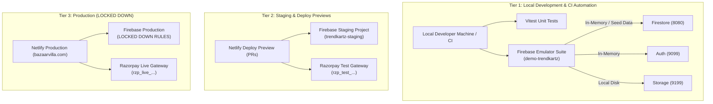

# TASK 001 — Development Environment, Safety Baseline & Testing Strategy

**Document Status:** COMPLETE  
**Date:** November 2026  
**Auditor / Agent Roles:** Principal Software Architect, Senior Full-Stack Engineer, DevOps Engineer, Application Security Specialist  
**Local Repository:** `C:\Users\Mayank Saini\Desktop\DeepuWebsite\trendzcart`  
**Git Branch:** `chore/relaunch-safety-baseline`  
**Target Commit Hash:** `9cd151a3f07858a2063be9c4b02477d8231b9d36`  
**Classification:** Development Safety Baseline & Testing Strategy (READ-ONLY AUDIT & PREPARATION)

---

## 1. Task Metadata

- **Task Identifier:** TASK-001
- **Task Title:** Development Environment, Safety Baseline & Testing Strategy
- **Execution Date:** 2026-11-08
- **Supervising Role:** External Software Architect
- **Operating Agent:** Antigravity AI Senior Engineering Agent
- **Target Repository:** `trendzcart` (Storefront: `TrendKartz` / Domain: `bazaarvilla.com`)
- **Git Branch Created & Active:** `chore/relaunch-safety-baseline`
- **Base Commit:** `9cd151a chore: replace favicon.ico with SVG icon file`
- **Task Status:** **COMPLETED** (Read-Only Engineering Investigation, Strategy Formulation, Test Specification)

---

## 2. Executive Summary

### 2.1 Objective
Establish an airtight engineering safety baseline, evaluate local development readiness, define a safe Firebase testing/staging strategy, verify dependency security, design critical security regression tests, and pinpoint the exact first security remediation required prior to any live commercial relaunch of the **TrendKartz** e-commerce platform.

### 2.2 Key Findings
1. **Git Isolation Established (VERIFIED):** Successfully created and checked out local branch [`chore/relaunch-safety-baseline`](file:///C:/Users/Mayank%20Saini/Desktop/DeepuWebsite/trendzcart). All uncommitted files (`Agent.md`, `docs/`) were safely preserved. No changes have been pushed to GitHub, preserving production deployment integrity on Netlify.
2. **Local Environment & Dependency State (VERIFIED):** Node.js runtime is `v24.15.0` with `npm` `11.12.1`. The local repository contains **no `node_modules` directory** and **no `.env` or `.env.example` file**. The application was previously run without tracked environment templates.
3. **Severe Dependency Vulnerabilities (VERIFIED):** A read-only audit of [`package-lock.json`](file:///C:/Users/Mayank%20Saini/Desktop/DeepuWebsite/trendzcart/package-lock.json) via `npm audit --package-lock-only` confirmed **34 vulnerabilities** (3 Critical, 17 High, 12 Moderate, 2 Low), including prototype pollution and remote code execution vectors in `protobufjs` (<=7.6.4), `websocket-driver` (<=0.7.4), and `axios` (1.0.0–1.19.0).
4. **Serverless Packaging Defect (VERIFIED):** [`firebase-admin`](file:///C:/Users/Mayank%20Saini/Desktop/DeepuWebsite/trendzcart/package.json#L29) is incorrectly installed in `devDependencies`. In production CI/CD builds pruning development packages, serverless API routes crash with `MODULE_NOT_FOUND`.
5. **No Test Infrastructure (VERIFIED):** There are currently zero unit, integration, or browser tests across the codebase.
6. **Production Fallback & Containment Hazard (VERIFIED):** The current code lacks Firebase Emulator configuration. Running the app locally with production credentials would connect directly to live Firestore, Storage, and Auth. Furthermore, the public site (`bazaarvilla.com`) remains vulnerable to client-side price tampering and unauthenticated order creation until remediated.

### 2.3 Overall Outcome
Task 001 completes with a comprehensive testing roadmap, 10 detailed security test specifications, an emulator/staging hybrid architecture, and an actionable blueprint for **Task 002: Server-Side Price & Order Integrity Remediation**.

---

## 3. Previous Context & Audit Baseline

The initial repository audit ([`docs/REPOSITORY_AUDIT.md`](file:///C:/Users/Mayank%20Saini/Desktop/DeepuWebsite/trendzcart/docs/REPOSITORY_AUDIT.md)) conducted an exhaustive static review of the codebase. The findings below form the verified baseline:

| Audit Finding ID | Category | Severity | Baseline Description | Current Verification Status |
|---|---|---|---|---|
| **RSK-01** | Security / Finance | **CRITICAL** | Client-controlled pricing in [`/api/orders/create`](file:///C:/Users/Mayank%20Saini/Desktop/DeepuWebsite/trendzcart/src/app/api/orders/create/route.ts#L42-L58) and [`/api/razorpay/create-order`](file:///C:/Users/Mayank%20Saini/Desktop/DeepuWebsite/trendzcart/src/app/api/razorpay/create-order/route.ts#L19-L30). Totals and item prices accepted directly from browser payload. | **VERIFIED** |
| **RSK-02** | Security / Integrity | **CRITICAL** | Unauthenticated order creation allowing arbitrary document overwrite in Firestore (`orders/{body.id}`). | **VERIFIED** |
| **RSK-03** | Security / Privacy | **HIGH** | Guest order lookup endpoint [`/api/orders/by-ids`](file:///C:/Users/Mayank%20Saini/Desktop/DeepuWebsite/trendzcart/src/app/api/orders/by-ids/route.ts#L22-L45) returns full PII (customer name, email, phone, street address) by order ID without verification or rate limits. | **VERIFIED** |
| **RSK-04** | Security / Auth | **HIGH** | Client-side role checking in [`AdminGuard.tsx`](file:///C:/Users/Mayank%20Saini/Desktop/DeepuWebsite/trendzcart/src/components/admin/AdminGuard.tsx#L15-L21) based on Firestore `users/{uid}`. No custom claims enforcement. | **VERIFIED** |
| **RSK-05** | Reliability / Payments | **HIGH** | Missing Razorpay server webhooks. Order persistence is delegated back to the client browser after payment verification. Dropped connections cause lost orders. | **VERIFIED** |
| **RSK-06** | Inventory | **HIGH** | Inventory counts in `products` are never decremented or checked during checkout. | **VERIFIED** |
| **RSK-07** | Dependencies | **HIGH** | 34 vulnerabilities in `package-lock.json`. | **VERIFIED** |
| **RSK-08** | Packaging | **MEDIUM** | `firebase-admin` declared in `devDependencies`. | **VERIFIED** |
| **RSK-12** | Testing | **CRITICAL** | Zero test coverage across the repository. | **VERIFIED** |

**Previous Audit Verdict:** **NO-GO for commercial transactions.**

---

## 4. Repository State & Git Baseline

### 4.1 Git Working Tree
- **Current Branch:** `chore/relaunch-safety-baseline` (branched from `main` at `9cd151a`).
- **Remote Origin:** `https://github.com/Coder-MayankSaini/trendzcart.git`
- **Working Tree State:** Untracked files preserved:
  - [`Agent.md`](file:///C:/Users/Mayank%20Saini/Desktop/DeepuWebsite/trendzcart/Agent.md) (local engineering rules)
  - [`docs/`](file:///C:/Users/Mayank%20Saini/Desktop/DeepuWebsite/trendzcart/docs/) (documentation directory)
- **Deployment Trigger Assessment:** Netlify is configured to deploy automatically on pushes to `main`. Working on local branch `chore/relaunch-safety-baseline` guarantees that commits made here **do not trigger Netlify production builds**.

### 4.2 Branching Strategy for Future Remediations
To maintain strict isolation and auditability:
```text
main (production branch, deployed via Netlify)
  └── chore/relaunch-safety-baseline (TASK 001 - environment & testing foundation)
        └── fix/sec-order-pricing-integrity (TASK 002 - P0 price & order security)
        └── feat/firebase-emulator-vitest (TASK 003 - local test harness & rules)
        └── fix/razorpay-webhooks-idempotency (TASK 004 - payment server webhooks)
```
- No direct commits to `main`.
- All remediation work occurs on dedicated feature/fix branches.
- Merges to `main` require explicit software architect and project owner approval after passing local regression test suites.

---

## 5. Development Environment Assessment

A detailed audit of local configuration files was conducted. Below are the 10 core determinations:

### 1. Node.js Version
- **Local Machine Runtime:** `v24.15.0`
- **Package Manifest Declarations:** [`package.json`](file:///C:/Users/Mayank%20Saini/Desktop/DeepuWebsite/trendzcart/package.json) contains no `engines` field. [`netlify.toml`](file:///C:/Users/Mayank%20Saini/Desktop/DeepuWebsite/trendzcart/netlify.toml) contains no `NODE_VERSION`. No `.nvmrc` exists.
- **Framework Compatibility:** Next.js `16.1.6` and React `19.2.3` officially target Node.js `>=20.9.0`. While Node.js `24.x` works locally, production serverless runtimes (Netlify Functions) default to `20.x` or `22.x` LTS.
- **Recommendation:** Pin Node.js to `20.x` or `22.x` LTS via `.nvmrc` and `NODE_VERSION = "20"` in `netlify.toml` to prevent environment drift.

### 2. Package Manager and Lockfile
- **Authoritative Tool:** `npm` (`11.12.1` locally).
- **Authoritative Lockfile:** [`package-lock.json`](file:///C:/Users/Mayank%20Saini/Desktop/DeepuWebsite/trendzcart/package-lock.json) (lockfileVersion 3).
- **Rule:** All dependency installations must strictly use `npm ci` rather than `npm install` once authorized.

### 3. Development Server Startup
- **Script:** `npm run dev` executes `next dev`.
- **Target URL:** `http://localhost:3000`
- **Current Blockers:** Cannot run `npm run dev` because `node_modules` is not installed, and environment variables are not populated.

### 4. Required Environment Variables
The application requires 12 distinct environment variables across client and server boundaries:

#### A. Client-Side (Public — bundled in frontend HTML/JS via `NEXT_PUBLIC_` prefix)
| Variable Name | Purpose in Code | Source File |
|---|---|---|
| `NEXT_PUBLIC_FIREBASE_API_KEY` | Firebase Web App API Key | [`src/lib/firebase/config.ts#L7`](file:///C:/Users/Mayank%20Saini/Desktop/DeepuWebsite/trendzcart/src/lib/firebase/config.ts#L7) |
| `NEXT_PUBLIC_FIREBASE_AUTH_DOMAIN` | Firebase Auth Handler Domain | [`src/lib/firebase/config.ts#L8`](file:///C:/Users/Mayank%20Saini/Desktop/DeepuWebsite/trendzcart/src/lib/firebase/config.ts#L8) |
| `NEXT_PUBLIC_FIREBASE_PROJECT_ID` | GCP Project ID | [`src/lib/firebase/config.ts#L9`](file:///C:/Users/Mayank%20Saini/Desktop/DeepuWebsite/trendzcart/src/lib/firebase/config.ts#L9) |
| `NEXT_PUBLIC_FIREBASE_STORAGE_BUCKET` | Cloud Storage Bucket Name | [`src/lib/firebase/config.ts#L10`](file:///C:/Users/Mayank%20Saini/Desktop/DeepuWebsite/trendzcart/src/lib/firebase/config.ts#L10) |
| `NEXT_PUBLIC_FIREBASE_MESSAGING_SENDER_ID` | Firebase Messaging Sender ID | [`src/lib/firebase/config.ts#L11`](file:///C:/Users/Mayank%20Saini/Desktop/DeepuWebsite/trendzcart/src/lib/firebase/config.ts#L11) |
| `NEXT_PUBLIC_FIREBASE_APP_ID` | Firebase App Registration ID | [`src/lib/firebase/config.ts#L12`](file:///C:/Users/Mayank%20Saini/Desktop/DeepuWebsite/trendzcart/src/lib/firebase/config.ts#L12) |
| `NEXT_PUBLIC_RAZORPAY_KEY_ID` | Razorpay Merchant Key ID (Public fallback) | [`src/app/api/razorpay/public-config/route.ts#L8`](file:///C:/Users/Mayank%20Saini/Desktop/DeepuWebsite/trendzcart/src/app/api/razorpay/public-config/route.ts#L8) |

#### B. Server-Side (Private Secrets — must NEVER leak to browser client)
| Variable Name | Purpose in Code | Source File |
|---|---|---|
| `FIREBASE_PROJECT_ID` | Service Account Project ID | [`src/lib/firebase/admin.ts#L8`](file:///C:/Users/Mayank%20Saini/Desktop/DeepuWebsite/trendzcart/src/lib/firebase/admin.ts#L8) |
| `FIREBASE_CLIENT_EMAIL` | Service Account Email Address | [`src/lib/firebase/admin.ts#L9`](file:///C:/Users/Mayank%20Saini/Desktop/DeepuWebsite/trendzcart/src/lib/firebase/admin.ts#L9) |
| `FIREBASE_PRIVATE_KEY` | Service Account RSA Private Key (PEM format) | [`src/lib/firebase/admin.ts#L10`](file:///C:/Users/Mayank%20Saini/Desktop/DeepuWebsite/trendzcart/src/lib/firebase/admin.ts#L10) |
| `RAZORPAY_KEY_ID` | Razorpay Merchant Key ID (Server order creation) | [`src/app/api/razorpay/create-order/route.ts#L8`](file:///C:/Users/Mayank%20Saini/Desktop/DeepuWebsite/trendzcart/src/app/api/razorpay/create-order/route.ts#L8) |
| `RAZORPAY_KEY_SECRET` | Razorpay HMAC-SHA256 Signature Secret | [`src/app/api/razorpay/verify-payment/route.ts#L9`](file:///C:/Users/Mayank%20Saini/Desktop/DeepuWebsite/trendzcart/src/app/api/razorpay/verify-payment/route.ts#L9) |

### 5. Existing Environment Templates
- **Status:** **NOT FOUND.**
- There is no `.env.example`, `.env.local.example`, or `.env.template` in the repository. New developers have no documented specification of required keys or their formatting.

### 6. Environment Distinction (Development vs. Staging vs. Production)
- **Status:** **ABSENT.**
- The application makes no distinction between environments. Code paths read `process.env.*` directly without checking `NODE_ENV` or an `APP_ENV` variable. There are no staging domain guards or environment-specific feature toggles.

### 7. Local Development Dependency on Production Firebase
- **Status:** **CRITICAL RISK (VERIFIED).**
- In [`src/lib/firebase/config.ts`](file:///C:/Users/Mayank%20Saini/Desktop/DeepuWebsite/trendzcart/src/lib/firebase/config.ts), client SDK connects directly to Firebase production servers.
- There are no calls to `connectFirestoreEmulator`, `connectAuthEmulator`, or `connectStorageEmulator`.
- In [`src/lib/firebase/admin.ts`](file:///C:/Users/Mayank%20Saini/Desktop/DeepuWebsite/trendzcart/src/lib/firebase/admin.ts), Admin SDK connects directly to production GCP via service account credentials.
- **Impact:** If a developer enters production Firebase keys locally to test features, any document created, updated, or deleted affects **LIVE PRODUCTION DATA**.

### 8. Razorpay Test Mode vs. Live Mode Separation
- **Status:** **UNSEPARATED (VERIFIED).**
- Razorpay mode is determined solely by the string value of `RAZORPAY_KEY_ID` (`rzp_test_...` vs `rzp_live_...`).
- The codebase lacks any validation to ensure test keys are used in development or live keys in production. There is no mock payment provider for automated tests.

### 9. Netlify Deploy Preview Production Leakage Risk
- **Status:** **HIGH RISK (VERIFIED).**
- If environment variables in Netlify are defined at the "Site" scope (default), all Netlify Deploy Previews and branch previews inherit the exact same production Firebase and Razorpay credentials.
- A pull request preview build could execute writes against the production Firestore database.

### 10. Local Availability of Firebase Admin Credentials
- **Status:** **UNAVAILABLE LOCALLY (VERIFIED).**
- In [`src/lib/firebase/admin.ts#L26-L28`](file:///C:/Users/Mayank%20Saini/Desktop/DeepuWebsite/trendzcart/src/lib/firebase/admin.ts#L26-L28), if `FIREBASE_CLIENT_EMAIL` or `FIREBASE_PRIVATE_KEY` are undefined, `admin.initializeApp` throws an error caught in lines 21–23.
- As a result, `adminDb`, `adminAuth`, and `adminStorage` export as `null`.
- When `adminDb` is `null`:
  - [`/api/orders/create`](file:///C:/Users/Mayank%20Saini/Desktop/DeepuWebsite/trendzcart/src/app/api/orders/create/route.ts#L31) returns HTTP 500: `"Order service is not configured"`.
  - [`/api/orders/by-ids`](file:///C:/Users/Mayank%20Saini/Desktop/DeepuWebsite/trendzcart/src/app/api/orders/by-ids/route.ts#L17) returns HTTP 500: `"Order service is not configured"`.
  - Server components querying Firestore fail silently or render empty catalog grids.

---

## 6. Firebase Emulator and Staging Strategy

To test and remediate security issues safely, development must be completely detached from production Firebase.

### 6.1 Approach 1: Firebase Local Emulator Suite

The Firebase Emulator Suite runs locally via the Firebase CLI and provides emulated endpoints for:
- **Cloud Firestore** (`localhost:8080`)
- **Firebase Authentication** (`localhost:9099`)
- **Cloud Storage** (`localhost:9199`)
- **Emulator UI** (`localhost:4000`)

#### Server-Side (Admin SDK) Integration with Emulator
When the environment variable `FIRESTORE_EMULATOR_HOST="127.0.0.1:8080"` is present, the Firebase Admin SDK automatically bypasses Google OAuth and routes all calls to the local emulator without requiring `FIREBASE_CLIENT_EMAIL` or `FIREBASE_PRIVATE_KEY`.
```typescript
// Example emulator initialization in src/lib/firebase/admin.ts
if (process.env.FIRESTORE_EMULATOR_HOST) {
    admin.initializeApp({ projectId: "demo-trendkartz" });
}
```

#### Client-Side Integration with Emulator
```typescript
// Example emulator connection in src/lib/firebase/config.ts
if (process.env.NEXT_PUBLIC_USE_FIREBASE_EMULATOR === "true") {
    connectFirestoreEmulator(db, "127.0.0.1", 8080);
    connectAuthEmulator(auth, "http://127.0.0.1:9099", { disableWarnings: true });
    connectStorageEmulator(storage, "127.0.0.1", 9199);
}
```

#### Emulator Test Coverage Capabilities:
- Product catalog queries (including compound index simulation).
- User registration and authentication flows.
- Firestore Security Rules testing via `@firebase/rules-unit-testing`.
- Admin role authorization and custom claims minting.
- Order creation transactions and inventory decrements.
- Guest order privacy restrictions.

#### Limitations of Emulator:
- External Google OAuth redirects require mocked browser interaction.
- Third-party webhooks (e.g., live Razorpay callbacks) cannot reach `localhost` without external tunneling (ngrok).
- Netlify Deploy Previews cannot access a local emulator.

---

### 6.2 Approach 2: Dedicated Firebase Staging Project

A dedicated Google Cloud / Firebase project (e.g., `trendkartz-staging`):
- Operates in the cloud with isolated Firestore, Auth, and Storage buckets.
- Paired with Razorpay Test Mode keys (`rzp_test_...`).
- Configured as the backend for Netlify Deploy Previews (`*.netlify.app`).

#### Capabilities:
- Full end-to-end checkout with real Razorpay Test Mode modal.
- Real Google Sign-In with authorized staging domains.
- Real Cloud Storage image compression and thumbnail uploads.
- Webhook endpoints accessible to Razorpay Test Webhook dispatchers.

---

### 6.3 Recommended Architecture: Two-Tier Hybrid Strategy



#### Production Fallback Guard (Fail-Safe)
To prevent tests or local development from accidentally mutating production data:
```typescript
// Guard pattern to enforce emulator in development and tests
if (process.env.NODE_ENV === "test" || process.env.USE_FIREBASE_EMULATOR === "true") {
    if (!process.env.FIRESTORE_EMULATOR_HOST) {
        throw new Error("CRITICAL SAFETY ERROR: Tests must run against the Firebase Emulator. Refusing to connect to production Firebase.");
    }
}
```

---

## 7. Dependency and Build Readiness

### 7.1 Dependency Vulnerability Audit (`npm audit --package-lock-only`)
- **Scan Type:** Offline, read-only static scan of `package-lock.json`.
- **Exit Code:** `1` (Vulnerabilities found).
- **Total Vulnerabilities:** **34** (2 Low, 12 Moderate, 17 High, 3 Critical).

#### Top Critical and High Vulnerabilities Identified
| Package | Severity | Advisory / CVE | Impact on TrendKartz |
|---|---|---|---|
| `protobufjs` (<=7.6.4) | **CRITICAL** | GHSA-66ff-xgx4-vchm<br/>GHSA-2pr8-phx7-x9h3<br/>GHSA-fx83-v9x8-x52w | Code injection through bytes field defaults; prototype injection in message constructors. Transitive dependency via `firebase-admin` -> `@google-cloud/firestore` -> `google-gax`. |
| `websocket-driver` (<=0.7.4) | **CRITICAL** | GHSA-mp7j-qc5w-4988<br/>GHSA-xv26-6w52-cph6 | Resource limit bypass via compression; message corruption via protocol length headers. |
| `axios` (1.0.0 - 1.19.0) | **HIGH** | GHSA-3p68-rc4w-qgx5<br/>GHSA-w9j2-pvgh-6h63 | SSRF bypasses via `NO_PROXY` normalization; authentication bypass via prototype pollution in `validateStatus`. Transitive via Firebase tooling. |
| `sharp` (<=0.35.5-rc.1) | **HIGH** | GHSA-f88m-g3jw-g9cj | Vulnerabilities in underlying `libvips` image processing binaries. Transitive via Next.js image optimization. |
| `@grpc/grpc-js` (<=1.13.5) | **HIGH** | GHSA-5375-pq7m-f5r2<br/>GHSA-99f4-grh7-6pcq | Malformed request causes server crash and DoS in Node.js serverless functions. Transitive via `firebase-admin`. |
| `zod` (<4.6.6) | **HIGH** | GHSA-mrhx-c7xc-m3w5 | Memory exhaustion DoS via oversized constrained collections. |

> [!CAUTION]
> **Do not execute `npm audit fix` or `npm audit fix --force`.**  
> Running `npm audit fix --force` would upgrade `next` to `16.4.5` and `firebase-admin` to `14.5.0` across major breaking boundaries, which risks breaking App Router routing and Firestore SDK integration. Dependency remediation must be executed surgically in a dedicated task.

---

### 7.2 Build and Verification Command Matrix

| Target Verification | Intended Command | Execution Status | Exit Code / Result | Operational Justification / Limitation |
|---|---|---|---|---|
| **Git Working Tree** | `git status` | **PASSED** | 0 | Working tree clean. `chore/relaunch-safety-baseline` active. |
| **Git Branch Check** | `git branch -a` | **PASSED** | 0 | Local branch verified. |
| **Node.js Runtime** | `node -v` | **PASSED** | `v24.15.0` | Host runtime confirmed. |
| **npm Runtime** | `npm -v` | **PASSED** | `11.12.1` | Host package manager confirmed. |
| **Lockfile Audit** | `npm audit --package-lock-only` | **FAILED (Findings)** | 1 | 34 vulnerabilities reported (3 Critical, 17 High). |
| **ESLint Check** | `npm run lint` / `eslint` | **SKIPPED** | N/A | `node_modules` is not installed; global `eslint` is absent. Executing requires `npm install`, which is prohibited under safety rules. |
| **TypeScript Check** | `tsc --noEmit` | **NOT AVAILABLE / SKIPPED** | N/A | No `tsc` script defined in `package.json`; global `tsc` not installed. |
| **Production Build** | `npm run build` | **SKIPPED** | N/A | Cannot execute `next build` without local `node_modules`. |
| **Unit Tests** | `npm test` | **NOT AVAILABLE** | N/A | No test framework or script configured in `package.json`. |
| **Integration Tests**| `npm run test:integration` | **NOT AVAILABLE** | N/A | No integration test harness configured. |
| **E2E Browser Tests** | `npx playwright test` | **NOT AVAILABLE** | N/A | Playwright not installed. |

---

## 8. Minimal Automated Testing Strategy

The repository requires a structured, lightweight testing pyramid:

```text
       ▲
      / \     Playwright (E2E) - Storefront Checkout, Admin Guard
     /   \    Firebase Emulator (Integration) - Security Rules, Orders API
    /_____\   Vitest (Unit) - Price Calculations, Signatures, Coupons
```

### 8.1 Tooling Recommendations

#### 1. Vitest (Unit & Business Logic Layer)
- **Why Vitest:** Extremely fast, native TypeScript support via Vite/esbuild, zero configuration required for pure functions, Jest-compatible API.
- **Target Areas:**
  - Price, subtotal, and tax calculation utilities.
  - Coupon discount algorithms (percentage vs. flat amount).
  - Razorpay HMAC-SHA256 signature verification logic.
  - Shipping address and phone number sanitization rules.
  - UUID and order receipt ID validators.

#### 2. Firebase Emulator Suite + Rules Unit Testing (Integration Layer)
- **Why Emulator:** Provides high-fidelity local emulation of Firestore transactions, batch writes, and Security Rules enforcement without network latency or cloud charges.
- **Target Areas:**
  - `/api/orders/create` server route integration with emulator Firestore.
  - Concurrency testing: parallel checkouts verifying inventory atomicity.
  - Firestore Security Rules: verifying unauthenticated writes to `orders`, `products`, `coupons` are denied.
  - Custom claims role-based access validation.

#### 3. Playwright (End-to-End User Journey Layer)
- **Why Playwright:** Cross-browser reliability, fast execution, powerful network mocking capabilities.
- **Target Areas:**
  - Storefront Critical Path: Catalog -> PDP -> Customizer -> Cart -> Checkout (COD flow).
  - Razorpay Mock Flow: Mocking the Razorpay checkout modal via `page.route()` to test prepaid completion without hitting payment servers.
  - Admin Route Protection: Confirming unauthenticated users and customers are redirected away from `/admin/*`.

### 8.2 Test Directory Structure Proposal
```text
trendzcart/
├── tests/
│   ├── unit/
│   │   ├── pricing.test.ts          # Price calculation & total verification
│   │   ├── coupons.test.ts          # Coupon discount rules & limits
│   │   ├── razorpay-signature.test.ts # HMAC verification algorithm
│   │   └── validation.test.ts       # Input schema & sanitization tests
│   ├── integration/
│   │   ├── orders-create.test.ts    # POST /api/orders/create against Firestore emulator
│   │   ├── orders-by-ids.test.ts    # POST /api/orders/by-ids access control tests
│   │   └── security-rules.test.ts   # Firestore & Storage rules test suite
│   ├── e2e/
│   │   ├── checkout-cod.spec.ts     # Cash on delivery checkout user journey
│   │   ├── admin-guard.spec.ts      # Role-based route guard verification
│   │   └── customizer.spec.ts       # Photo upload & text customization flow
│   └── fixtures/
│       ├── products.json            # Synthetic test catalog
│       ├── coupons.json             # Synthetic test coupons
│       └── orders.json              # Synthetic test orders
```

---

## 9. Critical Security Regression Test Specifications

The following 10 formal security test specifications address the known architectural vulnerabilities:

```text
================================================================================
TEST SPECIFICATION: SEC-TEST-001
================================================================================
Security Requirement: Price & Total Manipulation Prevention
Target Component:     POST /api/orders/create & POST /api/razorpay/create-order
Test Description:     Verify that client-supplied item prices, subtotals, and totals
                      are completely ignored or rejected, and that the backend
                      recalculates the exact total from Firestore product records.
Mock / Emulated Data: Product in Firestore: { id: "prod_1", price: 1000 }
Test Input:           POST payload containing:
                      {
                        items: [{ id: "prod_1", quantity: 2, price: 1 }],
                        subtotal: 2,
                        total: 2
                      }
Expected Result:      The API must reject the mismatched total (HTTP 400) OR
                      recalculate the order in Firestore with total: 2000.
                      An order with total: 2 must NEVER be created.
Recommended Framework:Vitest + Firebase Emulator (Integration)
Production Dependent: NO (Runs against Emulator)
================================================================================

================================================================================
TEST SPECIFICATION: SEC-TEST-002
================================================================================
Security Requirement: Payment Status Tampering Prevention
Target Component:     POST /api/orders/create
Test Description:     Verify that an unverified client cannot mark an order as "PAID"
                      without cryptographic payment gateway verification.
Mock / Emulated Data: None
Test Input:           POST /api/orders/create payload:
                      {
                        items: [...],
                        paymentMethod: "COD",
                        paymentStatus: "PAID"
                      }
Expected Result:      API must reject or override paymentStatus to "PENDING".
                      For COD, initial status must ALWAYS be "PENDING".
                      For prepaid, status "PAID" requires verified gateway payload.
Recommended Framework:Vitest + Firebase Emulator (Integration)
Production Dependent: NO
================================================================================

================================================================================
TEST SPECIFICATION: SEC-TEST-003
================================================================================
Security Requirement: Order Document Overwrite Prevention
Target Component:     POST /api/orders/create
Test Description:     Verify that submitting an existing order ID cannot overwrite
                      or modify an existing customer's order record in Firestore.
Mock / Emulated Data: Existing order in Firestore:
                      orders/ord_123 { total: 5000, shippingAddress: { fullName: "Victim" } }
Test Input:           POST /api/orders/create with id: "ord_123", shippingAddress: { fullName: "Attacker" }
Expected Result:      HTTP 409 Conflict OR server ignores client id and generates a
                      new UUID / auto-id. Existing order `ord_123` remains unmodified.
Recommended Framework:Firebase Emulator Integration Test
Production Dependent: NO
================================================================================

================================================================================
TEST SPECIFICATION: SEC-TEST-004
================================================================================
Security Requirement: Guest Order Privacy & PII Harvesting Restriction
Target Component:     POST /api/orders/by-ids
Test Description:     Verify that guest order lookup requires secondary authentication
                      (e.g., matching phone number or email) and cannot be enumerated.
Mock / Emulated Data: Order in Firestore: orders/ord_999 {
                        shippingAddress: { phone: "9876543210", email: "customer@example.com" }
                      }
Test Input:           POST /api/orders/by-ids with { ids: ["ord_999"] } without phone/email verification.
Expected Result:      HTTP 401 / 403 Forbidden OR PII fields (street address, phone,
                      email) stripped from response.
Recommended Framework:Vitest + Firebase Emulator Integration
Production Dependent: NO
================================================================================

================================================================================
TEST SPECIFICATION: SEC-TEST-005
================================================================================
Security Requirement: Administrative Authorization & Privilege Escalation Prevention
Target Component:     AdminGuard.tsx & Firestore Security Rules
Test Description:     Verify that an authenticated customer cannot elevate privileges
                      by writing `role: "admin"` to their own `users/{uid}` document.
Mock / Emulated Data: Authenticated user: uid="cust_01", token={ role: "customer" }
Test Input:           Firestore Client SDK: `updateDoc(doc(db, "users", "cust_01"), { role: "admin" })`
Expected Result:      Firestore Security Rules deny the write (PERMISSION_DENIED).
                      AdminGuard denies navigation to `/admin/*`.
Recommended Framework:@firebase/rules-unit-testing
Production Dependent: NO
================================================================================

================================================================================
TEST SPECIFICATION: SEC-TEST-006
================================================================================
Security Requirement: Server-Side Coupon Validation & Discount Calculation
Target Component:     POST /api/orders/create
Test Description:     Verify that invalid, expired, exhausted, or fabricated coupons
                      are rejected, and coupon discounts are calculated server-side.
Mock / Emulated Data: Coupon in Firestore: coupons/SAVE10 {
                        type: "percentage", value: 10, isActive: true, timesUsed: 5, usageLimit: 5
                      }
Test Input:           POST /api/orders/create with { couponCode: "SAVE10", couponDiscount: 500 }
Expected Result:      API rejects coupon as exhausted (HTTP 400) and does not apply
                      the client-submitted ₹500 discount.
Recommended Framework:Vitest + Firebase Emulator Integration
Production Dependent: NO
================================================================================

================================================================================
TEST SPECIFICATION: SEC-TEST-007
================================================================================
Security Requirement: Atomic Inventory Validation & Concurrency Protection
Target Component:     POST /api/orders/create (with inventory decrement logic)
Test Description:     Verify that an item with 1 unit of stock cannot be ordered twice
                      under concurrent checkout requests.
Mock / Emulated Data: Product in Firestore: products/prod_scarce { inventory: 1 }
Test Input:           Two simultaneous POST requests ordering quantity: 1 of prod_scarce.
Expected Result:      First request succeeds (HTTP 200, inventory decremented to 0).
                      Second request fails (HTTP 409 Out of Stock).
                      Inventory never becomes negative (-1).
Recommended Framework:Vitest + Firebase Emulator Integration
Production Dependent: NO
================================================================================

================================================================================
TEST SPECIFICATION: SEC-TEST-008
================================================================================
Security Requirement: Payment Signature & Order Association Verification
Target Component:     POST /api/razorpay/verify-payment
Test Description:     Verify that a signature generated for Razorpay order A cannot be
                      submitted to verify or authorize Razorpay order B.
Mock / Emulated Data: Secret: "test_secret"
Test Input:           Valid HMAC signature for "rzp_order_A|pay_123", submitted with
                      razorpay_order_id: "rzp_order_B".
Expected Result:      HTTP 400 Bad Request: "Invalid signature".
Recommended Framework:Vitest (Unit)
Production Dependent: NO
================================================================================

================================================================================
TEST SPECIFICATION: SEC-TEST-009
================================================================================
Security Requirement: Idempotent Payment & Webhook Handling
Target Component:     POST /api/webhooks/razorpay (Future Handler)
Test Description:     Verify that duplicate webhook event deliveries (`payment.captured`)
                      do not create duplicate order records or decrement inventory twice.
Mock / Emulated Data: Existing order in Firestore: orders/ord_rzp_123 { paymentStatus: "PAID" }
Test Input:           Duplicate webhook event payload with payment_id: "pay_duplicate_123".
Expected Result:      HTTP 200 OK (acknowledged), but no duplicate order created and
                      inventory remains untouched.
Recommended Framework:Vitest + Firebase Emulator Integration
Production Dependent: NO
================================================================================

================================================================================
TEST SPECIFICATION: SEC-TEST-010
================================================================================
Security Requirement: Interrupted & Failed Checkout Containment
Target Component:     POST /api/orders/create & Razorpay Checkout Flow
Test Description:     Verify that a failed payment does not leave an unfulfilled or
                      inconsistently marked "PAID" order in the system.
Mock / Emulated Data: None
Test Input:           Razorpay payment failure callback triggering failure recording.
Expected Result:      Order status recorded as "Payment_Failed", paymentStatus recorded
                      as "FAILED", inventory is not decremented, cart is preserved.
Recommended Framework:Playwright E2E Mock / Integration
Production Dependent: NO
================================================================================
```

---

## 10. Recommended First Security Remediation (TASK 002)

### 10.1 Issue Selection: Server-Side Price Recalculation & Order Integrity Hardening
- **Target Risk:** **RSK-01** and **RSK-02**
- **Severity:** **CRITICAL (P0)**
- **Justification:** Financial arbitrage is the single greatest immediate business risk. Any user with browser developer tools or Postman can currently purchase catalog items for ₹1 or mark high-ticket apparel as paid. Resolving this on the server establishes the authoritative trust boundary required for all subsequent e-commerce operations.

### 10.2 Technical Implementation Blueprint

#### 1. Problem Statement
In [`src/app/api/orders/create/route.ts#L42-L58`](file:///C:/Users/Mayank%20Saini/Desktop/DeepuWebsite/trendzcart/src/app/api/orders/create/route.ts#L42-L58), the route handler parses the incoming JSON body and directly commits `body.subtotal`, `body.discount`, `body.couponDiscount`, `body.total`, and `body.paymentStatus` into Firestore without validating prices against the `products` collection. Furthermore, it uses the client-provided `body.id` as the Firestore document key via `.doc(body.id).set()`, allowing document overwriting.

#### 2. Proposed Technical Solution
1. **Server-Side Price Lookup:**
   - Extract item IDs from `body.items`.
   - Batch-fetch products from Firestore `products` collection using `adminDb`.
   - Validate that each product exists, is active (`isVisible === true`), and extract its authoritative `price`.
   - Recalculate item subtotals: `sum(product.price * item.quantity)`.
2. **Server-Side Coupon Recalculation:**
   - If `body.couponCode` is provided, fetch `coupons/{code}` server-side.
   - Verify `isActive === true`, `expiryDate > now`, and `timesUsed < usageLimit`.
   - Compute allowable discount server-side; reject client-tampered discounts.
3. **Server-Side Total Calculation:**
   - Authoritative Total = `Recalculated Subtotal - Recalculated Coupon Discount + Shipping`.
   - If the client's submitted total differs from the server-calculated total by more than ₹0.01, reject the request with HTTP 400 (`"Price mismatch detected"`).
4. **Server-Generated Order ID:**
   - Replace client `body.id` with server-generated Firestore ID: `adminDb.collection("orders").doc()`.
   - Reject any attempt to overwrite existing order documents.
5. **Strict Payment Status Guard:**
   - For `paymentMethod === "COD"`, enforce `paymentStatus = "PENDING"`.
   - For `paymentMethod === "RAZORPAY"`, reject initial `paymentStatus = "PAID"` until verified against Razorpay payment capture.

#### 3. Files Likely to be Modified
- [`src/app/api/orders/create/route.ts`](file:///C:/Users/Mayank%20Saini/Desktop/DeepuWebsite/trendzcart/src/app/api/orders/create/route.ts)
- [`src/app/(storefront)/checkout/page.tsx`](file:///C:/Users/Mayank%20Saini/Desktop/DeepuWebsite/trendzcart/src/app/(storefront)/checkout/page.tsx) (to receive and use server-generated `orderId`)
- [`package.json`](file:///C:/Users/Mayank%20Saini/Desktop/DeepuWebsite/trendzcart/package.json) (move `firebase-admin` to `dependencies` to avoid serverless packaging failure)

#### 4. Required Tests
- Vitest unit tests covering pricing and coupon calculation functions.
- Integration tests simulating price manipulation attempts against Firestore emulator.

#### 5. Backward Compatibility & Deployment Risks
- **Low storefront risk:** The checkout frontend will receive the authoritative `orderId` in the JSON response from `/api/orders/create` and persist that ID locally.
- **Immediate Commercial Protection:** Completely eliminates ₹1 order exploits.

#### 6. Immediate Public Storefront Containment Assessment
> [!IMPORTANT]
> The storefront is currently publicly accessible on `bazaarvilla.com`. If live commercial transactions are possible or if real COD orders can be placed, **immediate containment is advised**:
> - Option A (Recommended): Request owner approval to disable the checkout submit button on `bazaarvilla.com` or display a "Storefront Under Maintenance" notice during checkout.
> - Option B: If the owner confirms that Razorpay is in Test Mode and COD orders are not fulfilled, the site can remain as a public preview while Task 002 is executed locally.
> - **Status:** **REQUIRES OWNER APPROVAL.**

---

## 11. Verification Results Log

All commands executed during this investigation were strictly read-only and non-destructive:

```text
================================================================================
VERIFICATION LOG: TASK 001
================================================================================
Command 1: git status; git branch -a; git log -1 --oneline
Exit Code: 0 (PASSED)
Summary:   Clean working tree on `main`, target commit 9cd151a.

Command 2: git checkout -b chore/relaunch-safety-baseline
Exit Code: 0 (PASSED)
Summary:   Successfully created and switched to local safety baseline branch.
           Untracked files (Agent.md, docs/) preserved.

Command 3: git remote -v
Exit Code: 0 (PASSED)
Summary:   Origin verified as https://github.com/Coder-MayankSaini/trendzcart.git.

Command 4: node -v; npm -v
Exit Code: 0 (PASSED)
Summary:   Node v24.15.0, npm 11.12.1 verified on host machine.

Command 5: Test-Path node_modules
Exit Code: 0 (PASSED)
Summary:   Returned False. Local node_modules is not present.

Command 6: npm audit --package-lock-only
Exit Code: 1 (PASSED - READ ONLY AUDIT)
Summary:   Identified 34 vulnerabilities (3 critical, 17 high, 12 moderate, 2 low)
           without mutating files or network dependencies.

Command 7: eslint -v; tsc -v
Exit Code: 1 (EXPECTED)
Summary:   Binaries not present globally, confirming reliance on local project
           installations which are currently pending owner authorization.
================================================================================
```

---

## 12. File Modification Summary

### Created Files
1. [`docs/task-reports/TASK-001-development-baseline.md`](file:///C:/Users/Mayank%20Saini/Desktop/DeepuWebsite/trendzcart/docs/task-reports/TASK-001-development-baseline.md) (This comprehensive baseline report)
2. [`docs/task-reports/INDEX.md`](file:///C:/Users/Mayank%20Saini/Desktop/DeepuWebsite/trendzcart/docs/task-reports/INDEX.md) (Central task tracking index)

### Modified Application Files
**NONE.** No application source code, configuration files, or environment files were created, edited, or deleted.

---

## 13. Outstanding Risks and Blockers

| Risk / Blocker ID | Severity | Status | Description | Required Action |
|---|---|---|---|---|
| **BLK-01** | **CRITICAL** | **BLOCKED** | `node_modules` is absent locally. Safe package installation via `npm ci` is required before builds, type checks, or local test suites can run. | Requires Owner Approval for `npm ci`. |
| **BLK-02** | **CRITICAL** | **NOT VERIFIED** | Production Firestore Security Rules and Storage Rules are not in the repository. Current live database permissions remain unknown. | Requires Owner to export rules from Firebase Console. |
| **BLK-03** | **HIGH** | **REQUIRES APPROVAL** | Public storefront (`bazaarvilla.com`) is vulnerable to client-side price tampering and unauthenticated order placement right now. | Immediate checkout containment decision by Owner. |
| **BLK-04** | **HIGH** | **BLOCKED** | Absence of `.env.local` or `.env.example` prevents safe local server startup. | Authorize `.env.example` creation with dummy values. |
| **BLK-05** | **HIGH** | **REQUIRES APPROVAL** | Razorpay operating mode (Live vs. Test) on production deployment is unconfirmed. | Project Owner confirmation required. |

---

## 14. Decisions Requiring Project Owner Approval

The external software architect and project owner must review and confirm the following 5 decisions before Task 002 begins:

1. **Permission to run `npm ci`:** May the agent run `npm ci` on local branch `chore/relaunch-safety-baseline` to establish local dependencies for running test runners and type verification?
2. **Immediate Public Checkout Containment:** Should checkout on `bazaarvilla.com` be temporarily disabled (or switched to maintenance mode) while P0 server-side security fixes are implemented?
3. **Razorpay Operating Mode Confirmation:** Is the active Razorpay account currently using **Test Keys** (`rzp_test_...`) or **Live Keys** (`rzp_live_...`)?
4. **Provision of Firebase Security Rules:** Can the project owner export and provide the active `firestore.rules` and `storage.rules` from the Firebase Console so they can be versioned in the repository?
5. **Approval for First Remediation Scope:** Does the architect approve proceeding with **TASK 002: Server-Side Price & Order Integrity Remediation** as specified in Section 10?

---

## 15. Recommended Next Task

### Proposed Task: TASK 002 — Server-Side Price & Order Integrity Remediation
- **Prerequisites:** Owner approval for `npm ci` and first remediation scope.
- **Target Branch:** `fix/sec-order-pricing-integrity` (branched from `chore/relaunch-safety-baseline`).
- **Core Scope:**
  1. Move `firebase-admin` from `devDependencies` to `dependencies` in `package.json`.
  2. Implement server-side price recalculation in [`src/app/api/orders/create/route.ts`](file:///C:/Users/Mayank%20Saini/Desktop/DeepuWebsite/trendzcart/src/app/api/orders/create/route.ts).
  3. Implement server-side order ID generation to prevent order overwrite.
  4. Implement server-side coupon validation against Firestore `coupons` collection.
  5. Enforce strict `paymentStatus` rules (COD = PENDING).
  6. Adapt [`src/app/(storefront)/checkout/page.tsx`](file:///C:/Users/Mayank%20Saini/Desktop/DeepuWebsite/trendzcart/src/app/(storefront)/checkout/page.tsx) to handle server-returned order IDs.
  7. Add unit tests for pricing calculations.

---

## 16. Context for the Next AI Agent

### Essential Architecture Details
- **Framework:** Next.js `16.1.6` App Router + React `19.2.3` + TypeScript `5`.
- **Database:** Google Cloud Firestore (NoSQL) accessed via Firebase Client SDK (client) and Firebase Admin SDK (serverless route handlers).
- **Current Branch:** `chore/relaunch-safety-baseline`.

### Verified Facts
- Working tree is clean on `chore/relaunch-safety-baseline`.
- `node_modules` does not exist locally. Do NOT run `npm install` or `npm audit fix`.
- 34 package vulnerabilities are verified via `npm audit --package-lock-only`.
- Order creation endpoint [`/api/orders/create`](file:///C:/Users/Mayank%20Saini/Desktop/DeepuWebsite/trendzcart/src/app/api/orders/create/route.ts) currently trusts all client-sent prices, totals, and payment statuses.
- No automated tests exist.

### Unverified Assumptions (DO NOT ASSUME)
- Do NOT assume Firebase production security rules prevent writes. Evidence suggests they may be open.
- Do NOT assume Razorpay keys are in test mode.
- Do NOT assume Netlify preview builds are isolated from production Firebase.

### What the Next Agent Must Read
1. [`docs/task-reports/TASK-001-development-baseline.md`](file:///C:/Users/Mayank%20Saini/Desktop/DeepuWebsite/trendzcart/docs/task-reports/TASK-001-development-baseline.md) (This document)
2. [`docs/task-reports/INDEX.md`](file:///C:/Users/Mayank%20Saini/Desktop/DeepuWebsite/trendzcart/docs/task-reports/INDEX.md)
3. [`docs/REPOSITORY_AUDIT.md`](file:///C:/Users/Mayank%20Saini/Desktop/DeepuWebsite/trendzcart/docs/REPOSITORY_AUDIT.md)
4. [`Agent.md`](file:///C:/Users/Mayank%20Saini/Desktop/DeepuWebsite/trendzcart/Agent.md)

### What the Next Agent Must Avoid
- **NEVER** push commits to `origin/main` or trigger Netlify builds.
- **NEVER** write or execute commands against production Firebase Firestore or Storage.
- **NEVER** execute `npm audit fix --force` or automatic package major upgrades.
- **NEVER** include real private keys, API secrets, or customer PII in any markdown report or log.
- **NEVER** modify application source code without explicit approval of the task specification.
