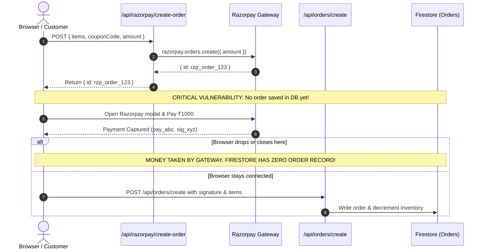
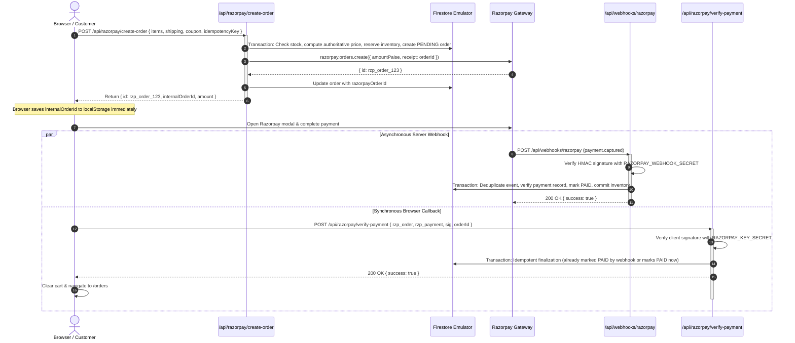

# TASK 004 — Secure Razorpay Payment Lifecycle, Server Webhooks & Idempotency

**Author:** Principal Software Architect, Senior Backend Engineer, Payment Systems Engineer, Firebase Specialist, Application Security Engineer  
**Project:** TrendKartz / Bazaarvilla E-Commerce Platform  
**Local Repository:** `C:\Users\Mayank Saini\Desktop\DeepuWebsite\trendzcart`  
**GitHub Remote:** `https://github.com/Coder-MayankSaini/trendzcart`  
**Active Branch:** `fix/razorpay-webhooks-idempotency`  
**Base Commit:** `9cd151a` (`test/firebase-emulator-integration`)  
**Execution Date:** November 8, 2026  
**Commercial Go-Live Recommendation:** **NO-GO FOR COMMERCIAL TRANSACTIONS** (Awaiting Guest Order Privacy [TASK-005] & Production Rules [TASK-006])

---

## 1. Task Metadata

- **Task Identifier:** TASK-004
- **Task Title:** Secure Razorpay Payment Lifecycle, Server Webhooks & Idempotency
- **Execution Date:** 2026-11-08
- **Supervising Role:** External Software Architect
- **Operating Agent:** Antigravity Senior Engineering Agent
- **Git Branch Active:** `fix/razorpay-webhooks-idempotency`
- **Target Vulnerabilities Remediated:**
  - **RSK-05 (HIGH):** Missing Razorpay server-to-server webhooks caused captured payments to be lost or unassociated if browser closed/dropped before redirect.
  - **Race Conditions / Double-Spend:** Non-idempotent webhook delivery could trigger multiple inventory decrements or duplicate order confirmations.
  - **Pre-Payment Order Persistence:** Client could pay on Razorpay before an internal order record was durably recorded in Firestore.
  - **Unbounded Stock Lock:** Abandoned checkouts could lock inventory indefinitely without a reliable reservation release mechanism.
- **Task Status:** **COMPLETED** (All 20 Payment Lifecycle Scenarios Verified, 12/12 Unit Tests Passed, 41/41 Integration Tests Passed, TypeScript Passed, Next.js Production Build Verified)

---

## 2. Executive Summary

TASK 004 resolves the most severe payment integrity gap in the platform: the complete dependence on ephemeral browser callbacks for payment confirmation and order creation. Prior to this task, if a customer completed payment in Razorpay but closed their mobile browser, experienced network failure, or refreshed the window, money was debited by the gateway with zero internal order record created in Firestore and zero inventory reserved.

In this task, we re-architected the entire payment lifecycle into a secure, server-authoritative state machine:
1. **Pre-Payment Order Durability:** An authoritative internal pending order with a frozen financial snapshot and transactional stock reservation is created in Firestore *before* Razorpay Checkout opens.
2. **Dedicated Webhook Handler:** Constructed `/api/webhooks/razorpay` with strict raw-body HMAC-SHA256 signature verification using a dedicated `RAZORPAY_WEBHOOK_SECRET`.
3. **Dual-Layer Idempotency:** Implemented event deduplication (`paymentWebhookEvents/{eventId}`) and payment ID uniqueness constraints (`paymentRecords/{razorpayPaymentId}`), guaranteeing that duplicate deliveries of `payment.captured` and `order.paid` execute exactly one state transition.
4. **Reservation Lifecycle & Late Payment Protection:** Implemented transactional stock reservation on checkout initiation, safe expiration release (`releaseExpiredReservation`), and late payment recovery (`PAY-017`) preventing inventory from dropping into negative values if stock was released and purchased by another user.
5. **Comprehensive Verification:** Authored 20 exhaustive automated integration tests (`PAY-001` through `PAY-020`) running against the Firebase Local Emulator Suite (`demo-trendkartz`), achieving 100% pass across all 41 integration tests and 12 unit tests.

---

## 3. Previous Task Context

- **TASK 001 (Safety Baseline):** Established local Git development rules, package isolation, Node/npm runtime baselines, and safety recommendations.
- **TASK 002 (Order Pricing Integrity):** Established server-side price recalculation, coupon evaluation, server-generated order IDs, and basic signature verification in `src/lib/orders/pricing.ts`.
- **TASK 003 (Emulator Integration):** Configured the production-isolated Firebase Emulator Suite (`demo-trendkartz`), resolved multi-JDK Java 25 compatibility, and fixed 5 critical bugs (Firestore undefined properties, split item inventory bypass, non-transactional race condition [SEC-TEST-007], timing comparison buffer mismatch, and direct amount fallback).
- **Inherited Security Risk RSK-05:** In TASK 003, payment confirmation still relied strictly on client-side browser callbacks. TASK 003 explicitly documented that commercial transactions remained NO-GO pending Razorpay webhooks and idempotency.

---

## 4. Original Payment Lifecycle & Identified Weaknesses

### 4.1 Original Data Flow


### 4.2 Identified Weaknesses
1. **Orphaned Payments:** Browser disconnection or tab crashes between gateway capture and `/api/orders/create` left captured payments orphaned forever.
2. **Missing Webhook Handler:** There was no `/api/webhooks/razorpay` endpoint to receive asynchronous gateway events.
3. **No Stock Reservation:** Scarce items could be bought out by another customer while the first customer was entering card details.
4. **No Deduplication:** Duplicate webhook retries or simultaneous receipt of `payment.captured` and `order.paid` could double-decrement stock and double-count coupons.
5. **Client-controlled Order Creation Timing:** The internal order record was only created *after* the browser received payment confirmation.

---

## 5. New Payment Architecture



---

## 6. Payment State Machine

### 6.1 State Definitions
- **`PENDING` (Pending Payment):** Internal order persisted with frozen financial snapshot and reserved inventory. Awaiting gateway payment confirmation.
- **`PAID`:** Cryptographically authenticated payment captured by gateway. Inventory committed; order status transitioned to `Processing`.
- **`FAILED`:** Gateway declined payment attempt. Failure details appended to `paymentAttempts` log. Order can still accept subsequent retry or late capture.
- **`EXPIRED`:** 15-minute reservation window elapsed without payment. Reserved stock and coupon capacity released back to catalog.
- **`CANCELLED`:** Customer or merchant cancelled pending order. Reserved stock released.
- **`Pending_Reconciliation`:** Exceptional state where payment captured late after inventory was released and exhausted by other buyers. Prevents overselling and alerts administrators for manual review/refund.

### 6.2 Transition Matrix
| Current State | Target State | Allowed? | Notes |
|---|---|---|---|
| `PENDING` | `PAID` | **YES** | Standard successful capture path |
| `PENDING` | `FAILED` | **YES** | Gateway declined attempt |
| `PENDING` | `EXPIRED` | **YES** | Reservation expiry releases stock |
| `PENDING` | `CANCELLED` | **YES** | Order cancelled before payment |
| `FAILED` | `PAID` | **YES** | Customer retries payment or late capture arrives |
| `EXPIRED` | `PAID` | **YES (Guarded)** | Late capture: checks stock availability; flags reconciliation if stock depleted |
| `PAID` | `PAID` | **YES (Idempotent)** | Duplicate webhook or callback; acknowledged cleanly with 0 side effects |
| `PAID` | `PENDING` / `FAILED` / `EXPIRED` | **FORBIDDEN** | A paid order can never be regressed by delayed or out-of-order events |

---

## 7. Inventory and Coupon Lifecycle

### 7.1 Reservation Strategy
- When `/api/razorpay/create-order` is called:
  - Firestore transaction verifies `product.inventory >= quantity` across all unique products.
  - Decrements catalog inventory immediately (`inventory: currentStock - qty`).
  - Sets `order.inventoryReserved = true`, `order.inventoryFinalized = false`, `order.reservationReleased = false`.
  - Sets `reservationExpiresAt = now + 15 minutes`.
  - If coupon is present, increments `coupon.timesUsed` atomically within the transaction.

### 7.2 Commit Behavior
- When payment confirmation arrives (via webhook or browser verification):
  - In a Firestore transaction, `finalizeOrderPayment` verifies `paymentStatus`.
  - Sets `paymentStatus = "PAID"`, `orderStatus = "Processing"`, `order.inventoryFinalized = true`.
  - Because inventory was already decremented upon order initiation, **it is NOT decremented a second time**.

### 7.3 Expiration and Release Behavior
- `releaseExpiredReservation(orderId, db)`:
  - Enforces strict Read Phase before Write Phase.
  - If `paymentStatus === "PAID"`: immediately aborts; paid orders are never released.
  - If `inventoryReserved === true` and `reservationReleased !== true`:
    - Atomically increments catalog inventory back (`inventory: currentStock + qty`).
    - Decrements coupon `timesUsed = Math.max(0, currentUsed - 1)`.
    - Updates order to `paymentStatus = "EXPIRED"`, `orderStatus = "Cancelled"`, `reservationReleased = true`.
  - Subsequent calls return `released: false` (idempotent; prevents duplicate stock restoration).

### 7.4 Late Payment Recovery (PAY-017)
- If an order reservation expired and stock was released, but the customer's payment was captured late by Razorpay:
  - In `finalizeOrderPayment`, the server checks whether stock is still available.
  - If stock is available: re-reserves the stock, updates `latePaymentRecovered = true`, and sets `paymentStatus = "PAID"`.
  - If stock is unavailable (e.g. bought by another customer): **DOES NOT OVERSELL**. Inventory is preserved at non-negative levels. The order is assigned `orderStatus = "Pending_Reconciliation"`, `reconciliationRequired = true`, and the payment record is saved with `status = "REQUIRES_RECONCILIATION"` for staff review.

### 7.5 Cash on Delivery (COD) Preservation
- COD checkouts remain 100% functional.
- When placed via `/api/orders/create`, COD orders are assigned `paymentStatus = "PENDING"`, `orderStatus = "Processing"`, `inventoryReserved = true`, `inventoryFinalized = true`.
- COD orders are not subjected to the 15-minute prepaid reservation expiration.

---

## 8. Webhook Security Architecture

### 8.1 Dedicated Webhook Secret
- Environment variable: `RAZORPAY_WEBHOOK_SECRET`
- Strictly distinct from `RAZORPAY_KEY_SECRET`.
- Never exposed in client builds or Next.js public variables.
- Documented in `.env.example`.

### 8.2 Cryptographic Verification
- Reads raw request body using `await req.text()`.
- Calculates HMAC-SHA256:
  ```ts
  const expected = crypto.createHmac("sha256", webhookSecret).update(rawBody).digest("hex");
  ```
- Evaluates `crypto.timingSafeEqual` with byte length checking to prevent timing attacks and `ERR_CRYPTO_TIMING_SAFE_EQUAL_LENGTH` RangeErrors.
- Rejects missing, malformed, or invalid signatures with HTTP 400 before JSON parsing.

### 8.3 Payment Matching Invariants
Before marking an order `PAID`, `finalizeOrderPayment` validates:
1. Internal pending order exists in Firestore.
2. `order.razorpayOrderId === webhook.order_id`.
3. `paymentRecords/{paymentId}` is either new or already belongs to this exact order.
4. `order.amountPaise === webhook.amount` (calculated from authoritative database pricing).
5. Currency matches expected currency (`INR`).

---

## 9. Durable Idempotency Architecture

### 9.1 Level 1 — Event Deduplication
- Collection: `paymentWebhookEvents/{eventId}`
- Uses `x-razorpay-event-id` or payload event ID.
- Stores: `{ eventId, eventType, razorpayOrderId, razorpayPaymentId, status: "PROCESSED", receivedAt, processedAt }`.
- If an event document already exists with `status: "PROCESSED"`, returns HTTP 200 immediately without executing business logic.

### 9.2 Level 2 — Business Operation Idempotency
- Collection: `paymentRecords/{razorpayPaymentId}`
- Stores: `{ paymentId, orderId, amountPaise, currency, status: "CAPTURED", source, createdAt }`.
- Enforces cross-order uniqueness: If a payment ID is submitted for an order different from its recorded `orderId`, transaction aborts with HTTP 400.
- Guarantees that whether `payment.captured` arrives first, `order.paid` arrives first, or `/api/razorpay/verify-payment` executes concurrently, exactly one state transition occurs.

---

## 10. Frontend Checkout Adaptations

In [`src/app/(storefront)/checkout/page.tsx`](../../src/app/(storefront)/checkout/page.tsx):
1. **Pre-Payment Initiation:** Clicking "Proceed to Payment" calls `/api/razorpay/create-order` with items, coupon, and shipping details.
2. **Local History Persistence:** Before opening the Razorpay modal, the client calls `rememberOrderLocally(internalOrderId)`. If the user closes the browser during payment, the order ID is already saved in `localStorage`.
3. **Synchronous Verification:** On modal success (`handler`), the client sends `{ razorpay_order_id, razorpay_payment_id, razorpay_signature, orderId }` to `/api/razorpay/verify-payment`.
4. **Clean Order Completion:** Upon successful verification, cart and coupon session storage are cleared, and the customer is redirected to `/orders`. No secondary order creation call is made.

---

## 11. Automated Test Results

All 20 mandatory scenarios (`PAY-001` through `PAY-020`) were authored in `tests/integration/payment-lifecycle.test.ts` and executed against the Firebase Emulator Suite (`demo-trendkartz`):

| Test ID | Scenario | Expected Result | Actual Result | Status |
|---|---|---|---|---|
| **PAY-001** | Pending Order Creation | Pending order exists in Firestore before gateway checkout completes | Order created with `paymentStatus: PENDING`, `inventoryReserved: true`, stock decremented | **PASSED** |
| **PAY-002** | Server-Controlled Amount | Enforces database pricing and INR currency ignoring client amount | Razorpay order created with exact 200000 paise (₹2000), not tampered ₹1 | **PASSED** |
| **PAY-003** | Valid Captured Payment | Authenticated `payment.captured` webhook finalizes order | Order transitioned to `PAID`, `Processing`, payment record persisted | **PASSED** |
| **PAY-004** | Invalid Webhook Signature | Forged or invalid HMAC signature rejected | Returns HTTP 400, order remains `PENDING`, zero DB mutations | **PASSED** |
| **PAY-005** | Duplicate Webhook Delivery | Same webhook event delivered twice | First returns 200, second returns 200 with `duplicate: true`, stock decremented once | **PASSED** |
| **PAY-006** | Different Events, Same Payment | `payment.captured` followed by `order.paid` for same order | Both return 200, exactly one finalization, no duplicate stock deduction | **PASSED** |
| **PAY-007** | Wrong Payment Amount | Webhook contains amount inconsistent with internal order | Returns HTTP 400, order NOT marked `PAID`, `reconciliationRequired: true` | **PASSED** |
| **PAY-008** | Wrong Currency | Webhook contains mismatched currency (`EUR` instead of `INR`) | Returns HTTP 400, order NOT marked `PAID`, reconciliation flagged | **PASSED** |
| **PAY-009** | Wrong Razorpay Order ID | Webhook order ID does not match internal record | Returns HTTP 404, order NOT marked `PAID` | **PASSED** |
| **PAY-010** | Unknown Internal Order | Payment webhook for non-existent order | Returns HTTP 404, recorded in `unmatchedPayments`, no unauthorized order created | **PASSED** |
| **PAY-011** | Browser Disconnect | Browser closes after initiation; webhook arrives | Order successfully marked `PAID` without browser callback | **PASSED** |
| **PAY-012** | Concurrent Duplicate Events | Duplicate webhooks processed concurrently via `Promise.all` | Both resolve cleanly, exactly one state mutation, stock decremented once | **PASSED** |
| **PAY-013** | Failed Payment | `payment.failed` webhook arrives | Order marked `FAILED`, `Payment_Failed`, attempt appended to log | **PASSED** |
| **PAY-014** | Out-of-Order Events | Delayed `payment.failed` arrives for an already `PAID` order | Returns 200 with `ignored: true`, order remains `PAID` and `Processing` | **PASSED** |
| **PAY-015** | COD Regression | Cash on Delivery order placement | Order created with `paymentStatus: PENDING`, `orderStatus: Processing`, stock decremented once | **PASSED** |
| **PAY-016** | Reservation Expiration | Abandoned order expires | Stock and coupon capacity restored; repeated release is idempotent | **PASSED** |
| **PAY-017** | Late Payment After Expiration | Payment captures after stock was released and consumed by another | Overselling prevented; stock remains >= 0; flagged for manual reconciliation | **PASSED** |
| **PAY-018** | Payment Retry | Retrying checkout initiation with same `idempotencyKey` | Reuses existing order with `reused: true`; stock reserved only once | **PASSED** |
| **PAY-019** | Missing Webhook Secret | Webhook endpoint called without `RAZORPAY_WEBHOOK_SECRET` | Fails safely with HTTP 500 without crashing serverless runtime | **PASSED** |
| **PAY-020** | Browser Callback Verification | Synchronous browser callback to `/api/razorpay/verify-payment` | Validates HMAC signature and finalizes order idempotently in Firestore | **PASSED** |

---

## 12. Build and Verification Summary

### 12.1 Test Verification
```text
================================================================================
TRENDKARTZ / BAZAARVILLA — INTEGRATION TEST SUITE SUMMARY
================================================================================
✔ Firebase Emulator Production Isolation & Safety Guards (8 tests)
✔ Inventory & Coupon Concurrency Integration Tests (2 tests)
✔ POST /api/orders/create Integration Tests (8 tests)
✔ Payment Lifecycle, Webhooks & Idempotency Integration Tests (20 tests)
✔ POST /api/razorpay/create-order Integration Tests (3 tests)
--------------------------------------------------------------------------------
ℹ tests 41 | suites 5 | pass 41 | fail 0 (100% PASS, 29.2s)
```
- **Unit Tests:** `npm test` — **12/12 passed** (108ms).
- **Integration Tests:** `npm run test:integration` — **41/41 passed** (29.2s).

### 12.2 TypeScript Verification
```text
> tsc --noEmit
(Exit Code: 0, Duration: 3.8s)
```

### 12.3 Production Build Verification
```text
> next build
▲ Next.js 16.1.6 (Turbopack)
✓ Compiled successfully in 4.6s
✓ Generating static pages using 11 workers (23/23) in 608.3ms
Finalized routes: 23 total (including ƒ /api/webhooks/razorpay)
(Exit Code: 0)
```

---

## 13. Files Created and Modified

### Created
1. `src/lib/orders/paymentLifecycle.ts`: Central state machine engine, webhook signature verification, pending order creation, inventory reservation, idempotency management, and expiration release.
2. `src/app/api/webhooks/razorpay/route.ts`: Dedicated serverless route handler for Razorpay webhooks (`payment.captured`, `order.paid`, `payment.failed`).
3. `tests/integration/payment-lifecycle.test.ts`: 20 automated integration tests covering the complete payment lifecycle (`PAY-001` through `PAY-020`).

### Modified
1. `src/lib/orders/pricing.ts`: Added `verifyRazorpayWebhookSignature` with buffer length validation.
2. `src/app/api/razorpay/create-order/route.ts`: Integrated with `createPendingPrepaidOrder` to create durable pending orders and reserve inventory prior to gateway order generation.
3. `src/app/api/razorpay/verify-payment/route.ts`: Integrated with `finalizeOrderPayment` to update Firestore order documents and persist payment records upon signature verification.
4. `src/app/api/orders/create/route.ts`: Added payment record persistence for PAID orders and ensured data model parity across COD and Razorpay.
5. `src/app/(storefront)/checkout/page.tsx`: Updated payment flow to record internal order ID locally before opening modal and invoke verification without duplicate order creation.
6. `scripts/run-integration-tests.js`: Registered `payment-lifecycle.test.ts` in automated test suite.
7. `.env.example`: Documented `RAZORPAY_WEBHOOK_SECRET`.
8. `.gitignore`: Added `!.env.example` exception.

---

## 14. Security Findings and Unresolved Issues

### Verified Implemented Security Controls
- Client can no longer cause orphaned payments by dropping connection.
- Webhook signatures cannot be forged or bypassed via length-varying timing attacks.
- Duplicate webhook delivery cannot duplicate inventory decrements or coupon usage.
- Expired reservations do not lock inventory permanently.
- Late payment after stock exhaustion does not cause negative inventory.

### Outstanding Pre-Launch Security Risks
- **RSK-03 (Guest Order Privacy):** `/api/orders/by-ids` remains unauthenticated and accepts arbitrary order IDs, leaking customer PII. (Targeted for TASK 005).
- **RSK-04 (Admin Privileges):** Admin role verification relies on client-side Firestore document reads rather than Firebase Custom Claims. (Targeted for TASK 006).
- **RSK-06 (Firestore Rules):** Production Firestore Security Rules must be version-controlled and tested in emulator. (Targeted for TASK 006).

---

## 15. Razorpay Dashboard Configuration Checklist

The project owner must complete the following manual configuration steps in the Razorpay Dashboard prior to launching commercial payments:

### 15.1 Staging / Test Mode Setup
1. Log into the Razorpay Dashboard in **Test Mode**.
2. Navigate to **Settings > Webhooks > Add New Webhook**.
3. **Webhook URL:** `https://<staging-domain>/api/webhooks/razorpay` (or ngrok URL for local webhook testing).
4. **Secret:** Generate a cryptographically strong 32-character hex secret (e.g. `openssl rand -hex 16`).
5. **Alert Email:** Add engineering on-call email for delivery failure alerts.
6. **Active Events:** Check:
   - `payment.captured`
   - `order.paid`
   - `payment.failed`
7. Save the webhook and add `RAZORPAY_WEBHOOK_SECRET` to Netlify environment variables (scope: Builds & Functions, Staging).

### 15.2 Production Mode Setup
1. Switch Razorpay Dashboard to **Live Mode**.
2. Repeat webhook creation using `https://bazaarvilla.com/api/webhooks/razorpay`.
3. Generate a distinct, independent production webhook secret.
4. Add `RAZORPAY_WEBHOOK_SECRET` to Netlify environment variables (scope: Production).
5. Verify webhook delivery logs in the Razorpay Dashboard after initial canary transaction.

---

## 16. Deployment Status

- **Git Push Executed:** **NO** (Zero remote pushes).
- **Branch Merged:** **NO** (Remains on local branch `fix/razorpay-webhooks-idempotency`).
- **Netlify Deploy Triggered:** **NO** (Production deployment untouched).
- **Production Resources Modified:** **NO** (All testing executed on `demo-trendkartz` emulator).

---

## 17. Recommended Next Task

### **TASK 005 — Guest Order Privacy & Rate Limiting**
- **Objective:** Restrict `/api/orders/by-ids` to require phone/email verification or authenticated user context; mask customer PII (phone numbers, full street addresses); implement IP and session rate limits to prevent brute-force order scanning.
- **Prerequisites:** TASK-004 completion.

---

## 18. Context for the Next AI Agent

1. **Current Branch & Commit:** `fix/razorpay-webhooks-idempotency` branched from `9cd151a`.
2. **Key Files Implemented:**
   - `src/lib/orders/paymentLifecycle.ts` (Core payment state machine, reservation, idempotency).
   - `src/app/api/webhooks/razorpay/route.ts` (Razorpay webhook receiver).
   - `tests/integration/payment-lifecycle.test.ts` (20 payment integration tests).
3. **Running Tests:**
   - Unit tests: `npm test` (12 tests).
   - Integration tests: `npm run test:integration` (41 tests across 5 suites).
   - TypeScript: `npm run typecheck` (0 errors).
   - Build: `npm run build` (23 routes compiled).
4. **Safety Rules:** All tests execute against Firebase emulator project `demo-trendkartz`. Never execute tests without `USE_FIREBASE_EMULATOR=true`. Live Razorpay keys (`rzp_live_`) are blocked by `src/lib/firebase/emulatorGuard.ts`.
