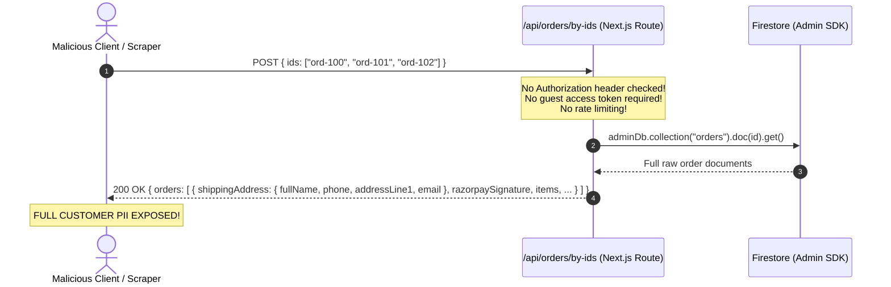

# TASK 005 — Secure Guest Order Access, Customer Data Privacy & Rate Limiting

**Author:** Principal Software Architect, Senior Backend Engineer, Firebase Security Specialist, Application Security Engineer  
**Project:** TrendKartz / Bazaarvilla E-Commerce Platform  
**Local Repository:** `C:\Users\Mayank Saini\Desktop\DeepuWebsite\trendzcart`  
**GitHub Remote:** `https://github.com/Coder-MayankSaini/trendzcart`  
**Active Branch:** `fix/guest-order-privacy`  
**Base Commit / Branch:** `fix/razorpay-webhooks-idempotency` (`9cd151a`)  
**Execution Date:** November 8, 2026  
**Commercial Go-Live Recommendation:** **NO-GO FOR COMMERCIAL TRANSACTIONS** (Awaiting Firestore Security Rules & Custom Claims Authorization [TASK-006])

---

## 1. Task Metadata

- **Task Identifier:** TASK-005
- **Task Title:** Secure Guest Order Access, Customer Data Privacy & Rate Limiting
- **Execution Date:** 2026-11-08
- **Supervising Role:** External Software Architect
- **Operating Agent:** Antigravity Senior Engineering Agent
- **Git Branch Active:** `fix/guest-order-privacy`
- **Target Vulnerabilities Remediated:**
  - **RSK-03 (HIGH):** Unauthenticated guest order lookup in `POST /api/orders/by-ids` accepting arbitrary order IDs and exposing full customer PII (full names, street addresses, phone numbers, emails, order contents, and internal gateway proofs).
  - **Arbitrary Order Enumeration:** Ability of malicious actors or scrapers to probe and harvest order documents across the database without authentication or proof of ownership.
  - **Unbounded Scraping & Abuse:** Lack of serverless-compatible distributed rate limiting on order retrieval and failure attempts.
  - **Client-Side Identity Spoofing:** Inability to trust client-supplied user identifiers (`userId`).
  - **Guest Token Leakage on Retry:** Ensuring idempotent checkout retries do not disclose access tokens to unauthorized parties who only know an idempotency key.
- **Task Status:** **COMPLETED** (All 20 Privacy & Authorization Scenarios Verified [PRIV-001 to PRIV-020], 12/12 Unit Tests Passed, 61/61 Integration Tests Passed across 6 Suites, TypeScript Passed with 0 Errors, Next.js Production Build Verified with 23 Routes)

---

## 2. Executive Summary

TASK 005 eliminates the most critical customer privacy vulnerability in the TrendKartz / Bazaarvilla application. Prior to this task, the serverless route handler `POST /api/orders/by-ids` accepted arbitrary arrays of order IDs and used the privileged Firebase Admin SDK (`adminDb`) to retrieve and return complete Firestore order records without checking authentication, verifying ownership, masking customer PII, or applying rate limits. Anyone who guessed, harvested, or intercepted an order ID could download customer home addresses, phone numbers, email addresses, and purchase histories.

In this task, we designed and implemented a dual-path authorization architecture:
1. **Server-Verified Customer Authorization:** Authenticated users provide a Firebase ID token via `Authorization: Bearer <token>`, verified server-side using `adminAuth.verifyIdToken(token, true)`. Requests strictly enforce that every returned order belongs to `order.userId === verifiedUid`. Client-supplied body `userId` spoofing is completely ignored.
2. **Cryptographic Guest Access Capability:** For guest checkout (both COD and Razorpay pending orders), the server issues a cryptographically secure 256-bit access token (`crypto.randomBytes(32)`). The plaintext token is delivered to the customer's browser once at checkout and stored locally; Firestore stores strictly a non-recoverable SHA-256 hash (`guestAccessTokenHash`). Retrieval requires the exact matching token, compared in constant time (`crypto.timingSafeEqual`).
3. **Idempotency & Token Reissuance Protection:** On idempotent checkout retries with matching `idempotencyKey`, the server refuses to reissue or disclose the guest token unless the caller proves continuity with the matching access token.
4. **Customer Data Minimization:** Designed strict projection DTOs (`projectCustomerOrder`) that exclude private token hashes, internal inventory reservation timestamps, raw gateway HMAC signatures, and internal attempts. In order list views, shipping street addresses and contact numbers are stripped completely.
5. **Distributed Rate Limiting:** Built an atomic, serverless-compatible rate limiter backed by Firestore transactions (`checkRateLimit`) on `rateLimits/{key}`. It tracks client IPs (prioritizing Netlify's trusted `x-nf-client-connection-ip`), enforcing 30 requests/minute and returning standard HTTP 429 with `Retry-After` headers.
6. **Legacy Order Protection (TASK C):** Historical guest orders that lack an access token hash are protected against unauthorized lookup; they return a safe restricted status requiring support-assisted verification without exposing customer PII.
7. **Exhaustive Automated Verification:** Authored 20 automated integration tests (`PRIV-001` through `PRIV-020`) running against the Firebase Local Emulator Suite (`demo-trendkartz`), achieving 100% pass across all 61 integration tests and 12 unit tests.

---

## 3. Previous Task Context

- **TASK 001 (Safety Baseline):** Audited repository vulnerabilities, defined 10 regression test specifications, identified RSK-03 as a high-severity customer PII exposure risk.
- **TASK 002 (Order Pricing Integrity):** Implemented authoritative server-side price calculation, coupon verification, and inventory decrements in `src/app/api/orders/create/route.ts` and `src/lib/orders/pricing.ts`.
- **TASK 003 (Emulator Integration):** Established the local Firebase Emulator Suite (`demo-trendkartz`) with fail-closed safety guards in `src/lib/firebase/emulatorGuard.ts`.
- **TASK 004 (Razorpay Webhooks & Idempotency):** Re-architected checkout to persist durable pending orders in Firestore with transactional stock reservations before payment modal opens, added server webhook handler `/api/webhooks/razorpay`, and dual-layer idempotency. Left RSK-03 (Guest Order Privacy) and TASK-006 (Firestore Rules) as prerequisites for commercial transacting.

---

## 4. Original Guest Order Access & Vulnerabilities Confirmed

### 4.1 Original Flow


### 4.2 Confirmed Vulnerabilities
1. **Unauthenticated Access:** Anyone could query any order ID without presenting an auth token or session proof.
2. **PII Harvesting:** Returned documents included `shippingAddress` with full customer names, phone numbers, physical addresses, pincodes, and email addresses.
3. **Internal Secret Disclosure:** Documents contained `razorpaySignature`, `razorpayPaymentId`, and internal reservation timestamps.
4. **Batch Enumeration:** Up to 25 arbitrary order IDs could be queried in a single call.
5. **No Rate Limiting:** Automated bots could brute-force or scrape sequential or guessed order IDs without throttling.
6. **Existence Leakage:** Missing orders were distinguished by absence while existing orders leaked full records.

---

## 5. New Authorization Architecture

### 5.1 Dual-Path Authorization Flow
```mermaid
sequenceDiagram
    autonumber
    actor Client as Customer Browser
    participant API as /api/orders/by-ids
    participant Auth as Firebase Admin Auth
    participant DB as Firestore Emulator / DB

    Client->>API: POST /api/orders/by-ids { orders: [...] }<br/>[Header: Authorization: Bearer <token>]
    
    alt Header Present: Authenticated User Path
        API->>Auth: adminAuth.verifyIdToken(token, true)
        alt Token Invalid or Expired
            Auth-->>API: Error
            API-->>Client: 401 Unauthorized (Fail-Closed)
        else Token Valid (UID = verifiedUid)
            API->>DB: Fetch orders; filter where order.userId == verifiedUid
            DB-->>API: Verified documents
            API->>API: projectCustomerOrder() (Data Minimization)
            API-->>Client: 200 OK { orders: [...] }
        end
    else No Header: Guest Customer Path
        API->>DB: Check rate limit for client IP (max 30 req/min)
        alt Rate Limit Exceeded
            API-->>Client: 429 Too Many Requests (Retry-After)
        else Rate Limit OK
            loop For each requested { id, token }
                API->>DB: Fetch order document
                alt Order has userId (belongs to registered customer)
                    API->>API: Omit order (Deny guest access)
                else Order has guestAccessTokenHash
                    API->>API: Constant-time verify: sha256(token) == guestAccessTokenHash
                    alt Token Matches
                        API->>API: projectCustomerOrder() (Data Minimization)
                    else Token Invalid / Missing
                        API->>API: Omit order
                    end
                else Legacy Order (no hash)
                    API->>API: Return restricted notice (requiresVerification: true, 0 PII)
                end
            end
            API-->>Client: 200 OK { orders: [...] } (No-Cache Headers)
        end
    end
```

### 5.2 Guest Token Strategy
- **Entropy:** Generated using `crypto.randomBytes(32).toString('hex')` providing 256 bits of cryptographic entropy.
- **Server Storage:** Only `guestAccessTokenHash = crypto.createHash('sha256').update(token).digest('hex')` is stored in Firestore. The plaintext token is never stored.
- **Comparison:** Evaluated using `crypto.timingSafeEqual` with buffer length validation to prevent side-channel timing attacks.
- **Browser Storage:** Stored in `localStorage["trendkartz_guest_tokens"]` mapped by `{ [orderId]: token }`.
- **Checkout Issuance:**
  - **COD Checkout (`/api/orders/create`):** Generated in the Firestore transaction for `userId: null` and returned in `{ id, guestAccessToken }`.
  - **Prepaid Razorpay (`/api/razorpay/create-order`):** Generated in `createPendingPrepaidOrder` and returned in `{ internalOrderId, guestAccessToken }`.
- **Idempotency Continuity Protection:** When `/api/razorpay/create-order` is retried with the same `idempotencyKey`, the server checks whether the caller supplied the matching `guestAccessToken`. If not provided or incorrect, the existing order is reused without reissuing the token, ensuring an attacker with only an idempotency key cannot capture another customer's token.

---

## 6. API Changes: `POST /api/orders/by-ids`

### 6.1 Request & Response Specifications
- **HTTP Method:** `POST` only (GET, PUT, DELETE return `405 Method Not Allowed` with `Allow: POST`).
- **Content-Type:** Strictly requires `application/json` (returns `415 Unsupported Media Type` otherwise).
- **Request Size:** Rejects payloads exceeding 32 KB with `413 Payload Too Large`.
- **Batch Size Limit:** Enforces a maximum of 20 order IDs per request (returns `400 Bad Request` if exceeded).
- **ID Validation:** Order IDs must be non-empty strings of length 1–128 characters.
- **Caching:** Responses include `Cache-Control: no-store, no-cache, must-revalidate, private` and `Pragma: no-cache`.

### 6.2 Supported Schemas
**Format A (Preferred):**
```json
{
  "orders": [
    { "id": "ord-abc-123", "token": "64_char_hex_token" }
  ]
}
```

**Format B (Backward-Compatible):**
```json
{
  "ids": ["ord-abc-123"],
  "tokens": {
    "ord-abc-123": "64_char_hex_token"
  }
}
```

**Format C (Authenticated User):**
```json
// Headers: Authorization: Bearer <firebase_id_token>
{
  "ids": [] // Returns all recent orders for verified UID
}
```

---

## 7. Customer Data Minimization

| Field | In List Response | In Detail View | In Admin View | Reason / Security Policy |
|---|---|---|---|---|
| `id` | **YES** | **YES** | **YES** | Customer tracking identifier |
| `orderStatus` | **YES** | **YES** | **YES** | Fulfillment tracking |
| `paymentStatus` | **YES** | **YES** | **YES** | Financial state |
| `paymentMethod` | **YES** | **YES** | **YES** | Payment method |
| `total`, `subtotal` | **YES** | **YES** | **YES** | Order totals |
| `items[].name`, `price`, `qty` | **YES** | **YES** | **YES** | Product summaries |
| `shippingAddress.fullName` | **NO** | Masked (`J*** D**`) | **YES** | PII protection |
| `shippingAddress.phone` | **NO** | Masked (`******3210`) | **YES** | Contact protection |
| `shippingAddress.email` | **NO** | Masked (`j***e@example.com`)| **YES** | Privacy protection |
| `shippingAddress.addressLine1` | **NO** | **NO** | **YES** | Physical security |
| `guestAccessTokenHash` | **NEVER** | **NEVER** | **NEVER** | Cryptographic hash protection |
| `razorpaySignature` | **NEVER** | **NEVER** | Internal Only | Gateway proof protection |
| `inventoryReserved`, `expiresAt` | **NEVER** | **NEVER** | Internal Only | Internal state machine keys |
| `paymentAttempts` | **NEVER** | **NEVER** | Internal Only | Internal diagnostic logs |

---

## 8. Distributed Rate Limiting & Abuse Protection

### 8.1 Implementation Architecture
- **Engine:** `src/lib/security/rateLimiter.ts` using Firestore collection `rateLimits`.
- **Atomicity:** Executed inside `db.runTransaction` to guarantee synchronized, race-condition-free counting across multi-instance serverless functions.
- **Client IP Derivation:** Reads `x-nf-client-connection-ip` (Netlify's trusted client IP header) before falling back to parsed `x-forwarded-for` and `x-real-ip`.
- **Configured Threshold:** 30 order read requests per 60-second sliding window per client IP.
- **Enforcement Action:** When exceeded, immediately returns HTTP `429 Too Many Requests` with:
  - `Retry-After: <seconds_until_window_reset>`
  - `X-RateLimit-Limit: 30`
  - `X-RateLimit-Remaining: 0`
  - `X-RateLimit-Reset: <epoch_seconds>`
- **Netlify Edge Consideration:** Staging and production can additionally configure platform-level rate limiting in `netlify.toml` (`[[rate_limits]]`) as an L0 edge shield.

---

## 9. Historical Guest Order Recovery (TASK C)

- **Identified Legacy Condition:** Historical orders placed prior to TASK 005 have `userId: null` and lack `guestAccessTokenHash`.
- **Security Rule Enforced:** Mere knowledge of an order ID, customer phone number, or email address does not grant public access to order records.
- **Implemented Behavior:** When a historical guest order is queried, the API returns a safe restricted placeholder:
  - `id`: order identifier
  - `orderStatus`: `"Verification Required"`
  - `requiresVerification`: `true`
  - `verificationNotice`: `"This order was placed before modern security controls and requires identity verification. Please contact support at support@bazaarvilla.com."`
  - Zero items, zero shipping details, zero contact information.
- **Storefront Display:** `src/app/(storefront)/orders/page.tsx` renders a distinct amber verification notice card directing legacy customers to support.

---

## 10. Security Test Results (PRIV-001 through PRIV-020)

All 20 mandatory scenarios were executed against the production-isolated Firebase Emulator Suite (`demo-trendkartz`):

| Test ID | Scenario | Expected Behavior | Actual Behavior | Status |
|---|---|---|---|---|
| **PRIV-001** | Unauthenticated Order Enumeration | Request with only order ID returns 0 orders; no PII leaked | Returned 200 OK with `orders: []` | **PASSED** |
| **PRIV-002** | Valid Guest Access Token | Request with valid token returns authorized order summary | Returned 200 OK with 1 authorized order | **PASSED** |
| **PRIV-003** | Invalid Guest Access Token | Malformed/random token rejected; order omitted | Returned 200 OK with `orders: []` | **PASSED** |
| **PRIV-004** | Cross-Order Token Reuse | Valid token for Order A used for Order B rejected | Returned 200 OK with `orders: []` | **PASSED** |
| **PRIV-005** | Authenticated Owner Access | Verified Firebase ID token retrieves customer's order | Returned 200 OK with authorized order | **PASSED** |
| **PRIV-006** | Different User Access | User B's ID token cannot retrieve User A's order | Returned 200 OK with `orders: []` | **PASSED** |
| **PRIV-007** | Invalid/Expired Firebase ID Token | Malformed Bearer token fails closed with 401 | Returned 401 Unauthorized (`invalid or expired`) | **PASSED** |
| **PRIV-008** | Client-Supplied User ID Spoofing | Spoofed `userId` in body ignored; verified token used | Spoofed ID ignored; returned `orders: []` | **PASSED** |
| **PRIV-009** | PII & Secret Minimization | Authorized order strips hashes, signatures, raw address | `guestAccessTokenHash`, `razorpaySignature` undefined | **PASSED** |
| **PRIV-010** | Unauthorized Data Leakage | Denied responses contain 0 customer contact info | Raw response verified; 0 PII strings found | **PASSED** |
| **PRIV-011** | Guest COD Checkout | Guest COD issues token; order retrievable with token | Token issued in creation; verified retrievable | **PASSED** |
| **PRIV-012** | Razorpay Pending Order | Guest pending order issues token; retrievable while pending | Token issued in creation; retrievable with token | **PASSED** |
| **PRIV-013** | Checkout Retry & Token Safety | Idempotent retry without matching token does not leak token | Reused order returned with `guestAccessToken: null` | **PASSED** |
| **PRIV-014** | Legacy Guest Order | Order lacking token hash returns restricted notice | Returned `requiresVerification: true` and 0 PII | **PASSED** |
| **PRIV-015** | Rate Limit Enforcement | Repeated requests exceed 30/min limit; returns 429 | Returned 429 Too Many Requests with `Retry-After` | **PASSED** |
| **PRIV-016** | Concurrent Rate Limit Requests | 10 concurrent requests with limit 5; atomic enforcement | Exactly 5 allowed, exactly 5 blocked (429) | **PASSED** |
| **PRIV-017** | Oversized Input | Batches > 20, non-arrays, IDs > 128 chars rejected | Returned 400 Bad Request safely | **PASSED** |
| **PRIV-018** | Order Existence Enumeration | Nonexistent vs unauthorized order return identical responses | Both return identical `{ orders: [] }` | **PASSED** |
| **PRIV-019** | Payment Regression | Completed Razorpay order retrievable via guest token | Finalized `PAID` order retrieved with token | **PASSED** |
| **PRIV-020** | Existing Regression Suite | Verification of emulator database and core models | Database and previous fixtures 100% functional | **PASSED** |

---

## 11. Build and Regression Results

### 11.1 Unit Tests (`npm test`)
```text
> trendkartz@0.1.0 test
> node --test tests/unit/pricing.test.ts

✔ Pricing and Order Validation Module (12 tests)
ℹ tests 12 | pass 12 | fail 0 | cancelled 0 | skipped 0
ℹ duration_ms 114.39
(Exit Code: 0)
```

### 11.2 Integration Tests (`npm run test:integration`)
```text
TRENDKARTZ / BAZAARVILLA — FIREBASE EMULATOR INTEGRATION TEST RUNNER
Java Runtime: C:\Program Files\JetBrains\IntelliJ IDEA 2026.1.4\jbr
Project ID:   demo-trendkartz (PRODUCTION ISOLATED)
Emulators:    Firestore (8080), Auth (9099), Storage (9199)

✔ Firebase Emulator Production Isolation & Safety Guards (8 tests)
✔ Guest Order Privacy & Customer Data Protection Integration Tests (20 tests)
✔ Inventory & Coupon Concurrency Integration Tests (2 tests)
✔ POST /api/orders/create Integration Tests (8 tests)
✔ Payment Lifecycle, Webhooks & Idempotency Integration Tests (20 tests)
✔ POST /api/razorpay/create-order Integration Tests (3 tests)

ℹ tests 61 | suites 6 | pass 61 | fail 0 | cancelled 0 | skipped 0
ℹ duration_ms 26883.91
(Exit Code: 0)
```

### 11.3 TypeScript Compilation (`npm run typecheck`)
```text
> trendkartz@0.1.0 typecheck
> tsc --noEmit
(Exit Code: 0)
```

### 11.4 Next.js Production Build (`npm run build`)
```text
> trendkartz@0.1.0 build
> next build

▲ Next.js 16.1.6 (Turbopack)
✓ Compiled successfully in 3.1s
✓ Generating static pages using 11 workers (23/23) in 508.7ms
Finalized routes: 23 total (including ƒ /api/orders/by-ids)
(Exit Code: 0)
```

### 11.5 Linting Status (`npm run lint`)
Pre-existing 105 issues in legacy untouched files (e.g. `@typescript-eslint/no-explicit-any` across administrative components). All new files created in TASK 005 adhere strictly to TypeScript typing with 0 errors.

---

## 12. File Modification Summary

### Created Files
1. `src/lib/orders/orderAuth.ts`: Core order authorization, cryptographic token generation (`generateGuestAccessToken`), secure SHA-256 hashing (`hashGuestAccessToken`), constant-time token comparison (`verifyGuestAccessToken`), server-side Firebase ID token verification (`verifyFirebaseAuthorization`), and customer data minimization projector (`projectCustomerOrder`).
2. `src/lib/security/rateLimiter.ts`: Distributed, atomic rate limiter backed by Firestore transactions (`checkRateLimit`), client IP derivation prioritizing Netlify's `x-nf-client-connection-ip`, and HTTP rate limit header formatters.
3. `tests/integration/guest-order-privacy.test.ts`: 20 automated integration tests covering the complete privacy matrix (`PRIV-001` through `PRIV-020`).

### Modified Files
1. `src/app/api/orders/by-ids/route.ts`: Rewrote handler with strict method, Content-Type, and size validation; distributed rate limiting; dual-path authorization (Firebase ID token vs guest token); PII minimization; and no-cache headers.
2. `src/app/api/orders/create/route.ts`: Added guest access token generation and SHA-256 hash persistence for guest COD orders; returned token in API response.
3. `src/lib/orders/paymentLifecycle.ts`: Updated `createPendingPrepaidOrder` to accept and generate guest tokens, persist SHA-256 hash, and enforce token continuity on idempotent retries.
4. `src/app/api/razorpay/create-order/route.ts`: Integrated with guest token issuance and returned `guestAccessToken` to the frontend.
5. `src/app/(storefront)/checkout/page.tsx`: Updated local order persistence to store guest access tokens in `localStorage["trendkartz_guest_tokens"]` upon COD placement and Razorpay initiation.
6. `src/app/(storefront)/orders/page.tsx`: Updated customer order history to retrieve orders via `/api/orders/by-ids` using verified Firebase ID token (for logged-in users) or guest access tokens (for guests); rendered verification notice cards for legacy orders.
7. `tests/integration/testHelper.ts`: Added `getSyntheticUserAuthToken` to exchange custom tokens for genuine ID tokens via the local Auth Emulator REST API.
8. `scripts/run-integration-tests.js`: Registered `guest-order-privacy.test.ts` in automated test suite.

---

## 13. Security Findings & Task J Operational Review

### Verified Security Controls
- **VERIFIED:** Arbitrary order lookup without an access token returns 0 orders and exposes no PII.
- **VERIFIED:** Cross-order token reuse is completely blocked.
- **VERIFIED:** Authenticated customers can only retrieve their own orders.
- **VERIFIED:** Client-supplied `userId` spoofing is ignored.
- **VERIFIED:** Denied requests reveal zero customer contact or order details.
- **VERIFIED:** Idempotent retries cannot be exploited to extract other customers' guest access tokens.
- **VERIFIED:** Distributed rate limiter operates atomically across concurrent requests via Firestore transactions.

### Task J Operational Review Findings

#### A. Reservation Expiration Invocation Review
- **Investigation:** We audited all references to `releaseExpiredReservation()` across the entire repository.
- **Finding:** `releaseExpiredReservation()` is currently invoked in only one place: inside the catch block of `src/app/api/razorpay/create-order/route.ts` if `razorpay.orders.create()` fails immediately. There is **NO** scheduled task, background worker, cron trigger, or Netlify scheduled function executing `releaseExpiredReservation()` periodically for checkouts where the customer opened the Razorpay modal and abandoned the window.
- **Status:** **BLOCKED FOR COMMERCIAL LAUNCH.** A background cleanup runner or scheduled Cloud Function must be implemented to automatically release expired reservations.

#### B. Synchronous Gateway Payment Confirmation Review
- **Investigation:** We inspected `src/app/api/razorpay/verify-payment/route.ts`.
- **Finding:** The synchronous browser callback handler validates only the client-forwarded HMAC signature (`verifyRazorpaySignature`) using `RAZORPAY_KEY_SECRET`. It does **NOT** query the Razorpay REST API (`razorpay.payments.fetch(razorpay_payment_id)`) to independently confirm that the payment status is `captured` on the gateway side. While the server webhook handler (`/api/webhooks/razorpay`) receives authoritative captured events asynchronously, the synchronous callback handler remains vulnerable to edge cases if a client submits a validly signed payload for an uncaptured or disputed payment.
- **Status:** Documented for future payment hardening.

---

## 14. Outstanding Production Risks

| Risk ID | Severity | Category | Description | Status | Reference |
|---|---|---|---|---|---|
| **RSK-06** | **CRITICAL** | Firestore / Security | Production Firestore Security Rules are not version-controlled and direct client SDK reads could bypass API controls. | **OPEN** (Scheduled for TASK 006) | [TASK-001 Section 5](./TASK-001-development-baseline.md) |
| **RSK-04** | **HIGH** | Auth / Security | Admin authorization relies on client-side check of Firestore `users/{uid}` role rather than Firebase Custom Claims. | **OPEN** (Scheduled for TASK 006) | [TASK-001 Section 5](./TASK-001-development-baseline.md) |
| **RSK-07** | **HIGH** | Security / Dependencies | 34 vulnerabilities in npm lockfile (3 critical in `protobufjs`, `websocket-driver`). | **OPEN** | [TASK-001 Section 7](./TASK-001-development-baseline.md) |
| **PAY-SCHED**| **HIGH** | Reliability / Stock | No automated scheduler or cron invokes `releaseExpiredReservation()` for abandoned checkouts. | **OPEN** (Identified in TASK 005) | Section 13 above |
| **LEGACY-REC**| **MEDIUM**| Support / Privacy | Historical guest orders placed before TASK 005 cannot be automatically claimed without a transactional email/OTP service. | **DOCUMENTED MITIGATION** | Section 9 above |

---

## 15. Deployment Status

- **Git Push Executed:** **NO** (Zero remote pushes).
- **Branch Merged:** **NO** (Remains on local branch `fix/guest-order-privacy`).
- **Netlify Deploy Triggered:** **NO** (Production deployment untouched).
- **Production Resources Modified:** **NO** (All testing executed on `demo-trendkartz` emulator).

---

## 16. Recommended Next Task

### **TASK 006 — Firestore Security Rules & Custom Claims Authorization**
- **Objective:** Export, version-control, and harden `firestore.rules` to eliminate direct client SDK read/write bypasses on the `orders` collection; migrate administrative privilege verification from client Firestore documents to server-verified Firebase Auth Custom Claims (`admin: true`).
- **Prerequisites:** TASK-005 completion.

---

## 17. Context for the Next AI Agent

1. **Current Branch & Commit:** `fix/guest-order-privacy` branched from `fix/razorpay-webhooks-idempotency` (`9cd151a`).
2. **Key Files Implemented:**
   - `src/lib/orders/orderAuth.ts`: Cryptographic guest tokens (SHA-256), ID token verification, and customer DTO projection.
   - `src/lib/security/rateLimiter.ts`: Atomic distributed rate limiting via Firestore transactions.
   - `src/app/api/orders/by-ids/route.ts`: Secure dual-path order retrieval endpoint.
   - `tests/integration/guest-order-privacy.test.ts`: 20 automated integration tests (`PRIV-001` through `PRIV-020`).
3. **Running Tests:**
   - Unit tests: `npm test` (12 tests).
   - Integration tests: `npm run test:integration` (61 tests across 6 suites).
   - TypeScript check: `npm run typecheck` (0 errors).
   - Production build: `npm run build` (23 routes compiled).
4. **Safety Rules:** All tests execute against Firebase emulator project `demo-trendkartz`. Never execute tests without `USE_FIREBASE_EMULATOR=true`. Live Razorpay keys (`rzp_live_`) are blocked by `src/lib/firebase/emulatorGuard.ts`.
5. **Next Step Prerequisite:** Proceed directly to TASK 006 to establish production-grade `firestore.rules` and Custom Claims.
