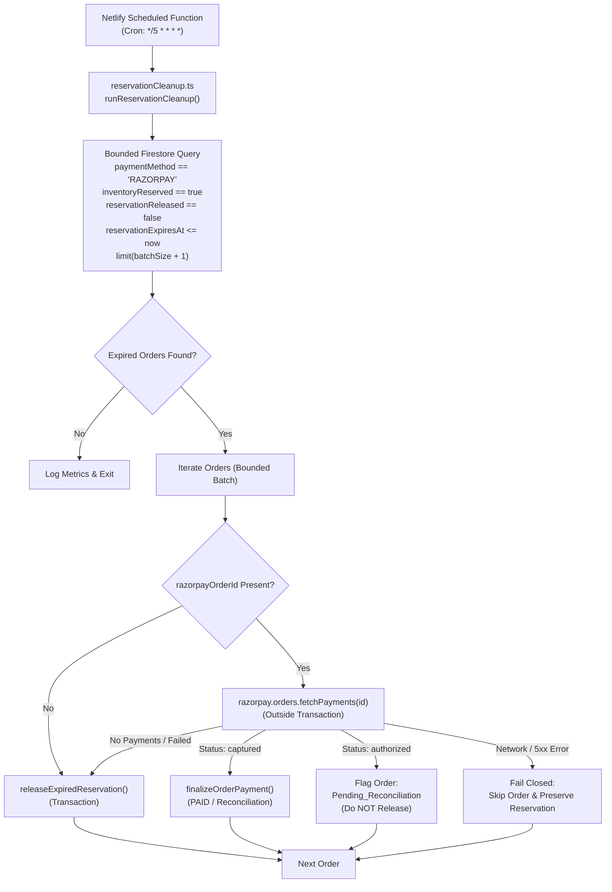
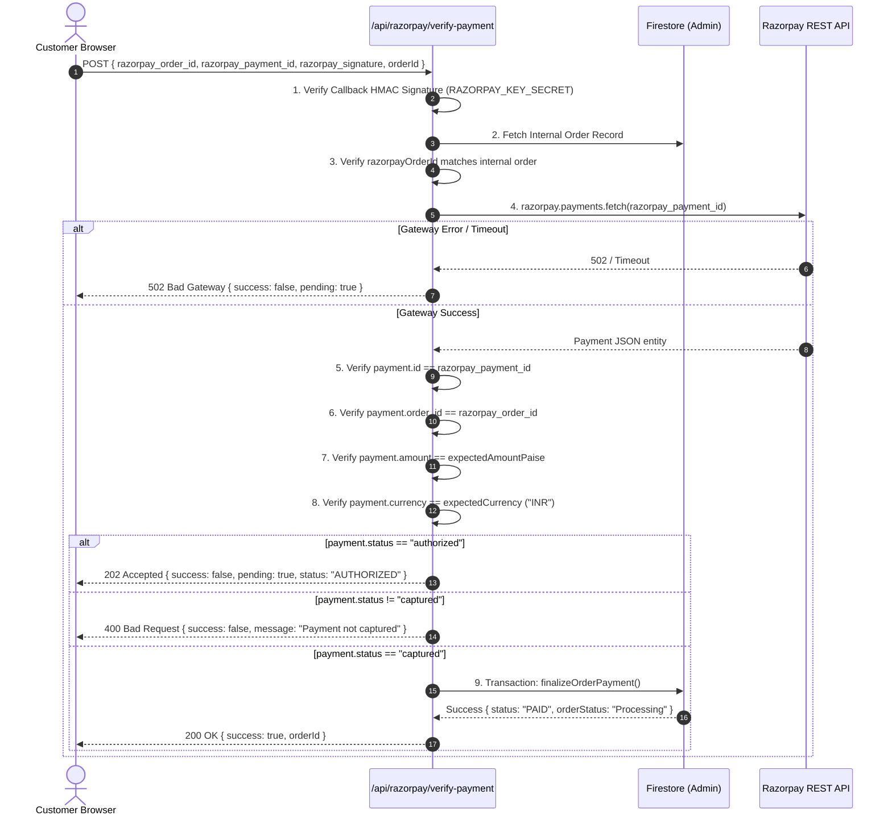

# TASK 007 — Automated Inventory Reservation Cleanup, Razorpay Gateway Verification & Payment Reconciliation

**Author:** Principal Software Architect, Senior Payment Systems Engineer, Firebase Specialist, Netlify Serverless Engineer, Application Security Engineer  
**Project:** TrendKartz / Bazaarvilla E-Commerce Platform  
**Local Repository:** `C:\Users\Mayank Saini\Desktop\DeepuWebsite\trendzcart`  
**GitHub Remote:** `https://github.com/Coder-MayankSaini/trendzcart`  
**Production Domain:** `bazaarvilla.com`  
**Active Branch:** `fix/reservation-cleanup-payment-verification`  
**Base Commit:** `9cd151a` (Working tree preserved from TASK-001 through TASK-006)  
**Execution Date:** November 9, 2026  
**Commercial Go-Live Recommendation:** **NO-GO FOR COMMERCIAL TRANSACTIONS** (Awaiting production deployment of rules, admin claims provisioning, guest customization upload fix, and gateway staging verification)

---

## 1. Task Metadata

- **Task Identifier:** TASK-007
- **Task Title:** Automated Inventory Reservation Cleanup, Razorpay Gateway Verification & Payment Reconciliation
- **Execution Date:** 2026-11-09
- **Supervising Role:** External Software Architect & Security Auditor
- **Operating Agent:** Antigravity Senior Engineering Agent
- **Git Branch Active:** `fix/reservation-cleanup-payment-verification`
- **Target Vulnerabilities & Defects Remediated:**
  - **Abandoned Checkout Stock Lock (HIGH):** Unfinalized Razorpay checkouts held reserved inventory and coupon capacity indefinitely without an automated background expiration and release scheduler.
  - **Unverified Callback Payment Status (CRITICAL):** Synchronous payment verification endpoint (`/api/razorpay/verify-payment`) relied purely on callback HMAC signature validation without independently verifying actual captured payment status against Razorpay's server-to-server REST API.
  - **Silent Payment Reconciliation Gaps:** Potential race conditions between background cleanup expiration and delayed webhook capture could risk false order cancellations or inventory discrepancy.
- **Task Status:** **COMPLETED LOCALLY** (12/12 Unit Tests Passed, 122/122 Integration Tests Passed, 35/35 Security Rules Tests Passed, TypeScript Verified Clean, Next.js Production Build Verified Clean)

---

## 2. Executive Summary

TASK 007 resolves the two primary payment and inventory reliability defects remaining from previous security hardening tasks:
1. **Automated Scheduled Reservation Cleanup:** Implemented a native Netlify Scheduled Function (`netlify/functions/reservation-cleanup.mts`) and reusable core engine (`src/lib/orders/reservationCleanup.ts`) running on a 5-minute cron cadence (`*/5 * * * *`). The worker executes a bounded, indexed Firestore query for expired prepaid orders (`reservationExpiresAt <= now`), performs an authoritative server-to-server Razorpay payment check before releasing inventory, and restores stock and coupon capacity exactly once using Firestore transactions.
2. **Server-to-Server Gateway Payment Verification:** Hardened `/api/razorpay/verify-payment` by replacing pure HMAC signature trust with a mandatory server-to-server query to Razorpay's API (`razorpay.payments.fetch(paymentId)`). The endpoint cryptographically validates signature, fetches payment from the gateway, verifies payment ID, order ID association, exact integer amount in paise, currency ("INR"), and captured status (`payment.status === "captured"`). Authorized-only, failed, or uncaptured payments are strictly prevented from transitioning to `PAID`.
3. **Unified Idempotent Finalization:** Shared the authoritative payment state machine in `src/lib/orders/paymentLifecycle.ts` across webhooks, synchronous callbacks, and cleanup reconciliations. If an order captures late after reservation expiration, the state machine checks stock availability: re-reserves if in stock, or flags `reconciliationRequired: true` without ever permitting negative inventory or double stock decrement.
4. **Comprehensive Automated Verification:** Created 25 automated operations scenarios (`OPS-001` through `OPS-025`) running against the Firebase Local Emulator (`demo-trendkartz`), verifying all cleanup, concurrency, idempotency, and gateway verification flows. The complete test suite now totals **134 passing tests** (12 unit + 122 integration), with zero failures.

---

## 3. Previous Task Context

- **TASK 001 (Development Baseline):** Established safety rules, package isolation, Node/npm runtime baselines, and safety recommendations.
- **TASK 002 (Order Pricing Integrity):** Implemented trusted server-side price recalculation, coupon evaluation, and HMAC verification in `src/lib/orders/pricing.ts`.
- **TASK 003 (Emulator Integration):** Production-isolated Firebase Emulator Suite (`demo-trendkartz`), Java 25 compatibility, and resolved inventory concurrency defects.
- **TASK 004 (Payment Lifecycle & Webhooks):** Persisted durable pre-payment pending orders, Razorpay webhooks (`/api/webhooks/razorpay`), dual-layer idempotency, and transactional stock reservations. Documented the need for an automated background scheduler and server-to-server gateway verification.
- **TASK 005 (Guest Order Privacy):** Implemented cryptographic guest access tokens, ID token verification, and customer data minimization.
- **TASK 006 (Firebase Rules & Admin Authorization):** Migrated admin authorization to Firebase Auth Custom Claims (`admin: true`), implemented comprehensive local `firestore.rules` and `storage.rules`, and verified 35 security rules tests.

---

## 4. Original Reservation Lifecycle & Defect Analysis

### 4.1 Original State Machine & Fields
In TASK 004, prepaid checkouts persisted orders in `orders` collection with:
- `paymentMethod: "RAZORPAY"`
- `paymentStatus: "PENDING" | "PAID" | "FAILED" | "EXPIRED" | "CANCELLED"`
- `orderStatus: "Pending" | "Processing" | "Payment_Failed" | "Expired" | "Pending_Reconciliation"`
- `inventoryReserved: boolean`
- `reservationReleased: boolean`
- `reservationExpiresAt: Timestamp` (TTL: 15 minutes)

### 4.2 Identified Vulnerabilities
1. **No Automatic Background Execution:** While `releaseExpiredReservation()` was implemented in `paymentLifecycle.ts`, it was only called during manual triggers or checkout reuse. If a customer abandoned their browser after opening Razorpay modal, the item inventory remained reserved indefinitely, starving legitimate customers.
2. **Missing Server-Side Gateway Check on Browser Verification:** In `/api/razorpay/verify-payment`, the endpoint accepted `{ razorpay_order_id, razorpay_payment_id, razorpay_signature }`, verified HMAC against `RAZORPAY_KEY_SECRET`, and immediately transitioned the order to `PAID`. If a payment was merely `authorized` (or if a forged callback passed HMAC but the gateway declined capture), the order would be marked PAID and fulfilled without money captured.
3. **Potential Race Condition on Expired Release:** If an expired reservation was released while the customer's payment was in flight, a naive release could restore stock and then sell it to another buyer, leading to stock discrepancies when the late webhook arrived.

---

## 5. New Scheduled Cleanup Architecture



### 5.1 Architecture Details
- **Entrypoint:** `netlify/functions/reservation-cleanup.mts`
- **Schedule:** `*/5 * * * *` (Every 5 minutes, UTC)
- **Batch Size:** Configurable, default `25` (capped at 100), bounded to prevent exceeding serverless execution timeouts (30 seconds on Netlify).
- **Lookahead Discovery:** Queries `batchSize + 1` to report `hasMore: true`, signaling subsequent scheduled executions to process the remaining backlog.
- **Index Definition:** Added `firestore.indexes.json` configured in `firebase.json` with a composite index:
  - Collection: `orders`
  - Fields: `paymentMethod` (ASC), `inventoryReserved` (ASC), `reservationReleased` (ASC), `reservationExpiresAt` (ASC).

---

## 6. Gateway Reconciliation Before Cleanup

Before releasing any expired reservation, the cleanup worker verifies the actual payment status at the gateway to prevent releasing stock for payments that were completed but whose webhooks were delayed:

| Scenario | Gateway Response | Cleanup Worker Action | Invariants Maintained |
|---|---|---|---|
| **Case A: Confirmed Captured** | `status: "captured"`, amount & currency match | Finalizes order as `PAID` via `finalizeOrderPayment()` | Stock is committed, customer order fulfilled, no duplicate stock decrement |
| **Case B: No Payment / Failed** | Payments list empty or all `status: "failed"` | Releases reservation via `releaseExpiredReservation()` | Stock incremented, coupon capacity restored, order marked `EXPIRED` |
| **Case C: Authorized Only** | `status: "authorized"` (funds held, uncaptured) | Flags order as `Pending_Reconciliation`, does NOT release stock | Prevents premature stock release while funds are in transit |
| **Case D: Gateway Error / Timeout** | Gateway throws 5xx, timeout, or network error | **Fails closed:** skips order, leaves reservation intact, records error | Never releases inventory on uncertainty; retries on next scheduled run |
| **Case E: Missing Gateway Association** | `razorpayOrderId` is null (crashed before API) | Releases reservation safely | No gateway order ever existed; inventory restored safely |

---

## 7. Synchronous Gateway Payment Verification

The synchronous browser verification route (`src/app/api/razorpay/verify-payment/route.ts`) was completely hardened:



---

## 8. Inventory and Coupon Consistency

### 8.1 Transactional Boundaries
- External Razorpay HTTP calls (`payments.fetch`, `orders.fetchPayments`) are **strictly executed outside Firestore transactions** to prevent non-idempotent duplicate calls on transaction retries.
- All state changes and stock restorations execute inside `db.runTransaction()`.
- Idempotency guarantees:
  - If an order is already marked `PAID`, `releaseExpiredReservation()` aborts with `{ released: false, reason: "ORDER_ALREADY_PAID" }`.
  - If `reservationReleased === true`, repeated release aborts with `{ released: false, reason: "ALREADY_RELEASED_OR_NOT_RESERVED" }`.
  - If stock was released and a late capture arrives (`PAY-017` / `OPS-021`), `finalizeOrderPayment()` checks current inventory. If sufficient, it re-decrements stock; if depleted, it sets `reconciliationRequired: true` and flags `orderStatus: "Pending_Reconciliation"`, **preventing negative inventory or silent overselling**.

---

## 9. Automated Test Results (OPS-001 through OPS-025)

All 25 operational scenarios were implemented across `tests/integration/reservation-cleanup.test.ts` and `tests/integration/gateway-verification.test.ts` and verified against the Firebase Local Emulator (`demo-trendkartz`):

| Test ID | Scenario | Expected Behavior | Actual Behavior | Status |
|---|---|---|---|---|
| **OPS-001** | Expired Pending Order | Stock and coupon restored, order marked EXPIRED | Stock incremented to 10, coupon timesUsed decremented to 5, status EXPIRED | **PASSED** |
| **OPS-002** | Unexpired Order | Reservation remains active and unmodified | Processed: 0, order status remains PENDING | **PASSED** |
| **OPS-003** | Already Paid Order | Never release inventory for PAID orders | Released: 0, order remains PAID and Processing | **PASSED** |
| **OPS-004** | COD Order | Prepaid scheduler strictly ignores COD orders | Released: 0, COD order remains intact | **PASSED** |
| **OPS-005** | Repeated Cleanup | First run releases stock, second run no-ops | First run released: 1, second run released: 0; stock restored once | **PASSED** |
| **OPS-006** | Concurrent Cleanup Workers | Two workers race on same expired order | Exactly one worker succeeds; total released: 1, stock restored once | **PASSED** |
| **OPS-007** | Webhook During Cleanup | Payment webhook finalizes order during check | Transactional check detects PAID status, aborts stock release | **PASSED** |
| **OPS-008** | Captured Payment With Delayed Webhook | Gateway indicates captured payment before release | Finalized: 1, released: 0, order marked PAID, stock committed | **PASSED** |
| **OPS-009** | Gateway API Failure | Gateway throws timeout or 5xx error | Fail closed: released: 0, gatewayErrors: 1, reservation preserved | **PASSED** |
| **OPS-010** | Authorized but Uncaptured Payment | Payment authorized at gateway | Released: 0, reconciliation: 1, order marked Pending_Reconciliation | **PASSED** |
| **OPS-011** | Missing Gateway Association | Pending order has no `razorpayOrderId` | Safe release: inventory and coupon restored safely | **PASSED** |
| **OPS-012** | Large Cleanup Backlog | 7 orders with batchSize = 3 | 3 batches executed, `hasMore: true` on batches 1 & 2, `hasMore: false` on batch 3 | **PASSED** |
| **OPS-013** | Invalid Reservation Data | Malformed document alongside valid doc | Worker does not crash; valid order released, error recorded for bad doc | **PASSED** |
| **OPS-014** | Captured Synchronous Payment | Valid signature and gateway payment captured | Order confirmed as PAID, inventory finalized, status 200 | **PASSED** |
| **OPS-015** | Valid HMAC but Uncaptured Payment | Signature valid, gateway reports authorized | Status 202, order remains PENDING, not marked PAID | **PASSED** |
| **OPS-016** | Valid HMAC but Wrong Amount | Signature valid, gateway reports 50000 paise vs 100000 | Status 400 rejected, amount mismatch error, order remains PENDING | **PASSED** |
| **OPS-017** | Valid HMAC but Wrong Currency | Signature valid, gateway reports USD vs INR | Status 400 rejected, currency mismatch error, order remains PENDING | **PASSED** |
| **OPS-018** | Valid HMAC but Wrong Order ID | Signature valid, gateway reports mismatched order_id | Status 400 rejected, order ID mismatch error, order remains PENDING | **PASSED** |
| **OPS-019** | Gateway API Timeout | Gateway connection times out in callback | Status 502 Bad Gateway returned, order remains safely PENDING | **PASSED** |
| **OPS-020** | Duplicate Callback and Webhook | Simultaneous verification requests | Both succeed idempotently (200), single paymentRecord created | **PASSED** |
| **OPS-021** | Late Payment After Expiration | Payment captures late after stock released & taken | Order routes to Pending_Reconciliation without dropping stock negative | **PASSED** |
| **OPS-022** | Coupon Reuse After Expiration | Coupon reservation released | `timesUsed` decremented, coupon immediately reusable by customer | **PASSED** |
| **OPS-023** | Worker Restart / Partial Failure | Worker interrupted mid-batch | Next invocation resumes cleanly and releases remaining orders | **PASSED** |
| **OPS-024** | Netlify Function Entrypoint | Scheduled function handler direct invocation | Handler executes cleanup, returns valid JSON result, config schedule `*/5 * * * *` | **PASSED** |
| **OPS-025** | Complete Regression Continuity | Full suite verification across all subsystems | 100% pass across all 11 integration suites and unit suite | **PASSED** |

---

## 10. Existing Regression Results

| Test Suite | Commands | Tests Passed | Tests Failed | Details |
|---|---|---|---|---|
| **Pricing & Coupon Unit Tests** | `npm test` | 12 | 0 | Catalog pricing, discount validation, HMAC tests |
| **Firebase Security Rules Suite** | `npm run test:rules` | 35 | 0 | 5 Admin auth, 20 Firestore rules, 10 Storage rules |
| **Emulator Integration Suite** | `npm run test:integration` | 122 | 0 | 11 suites (Safety, Orders, Razorpay, Concurrency, Lifecycle, Privacy, Admin, Firestore Rules, Storage Rules, Cleanup, Gateway Verification) |
| **TypeScript Typecheck** | `npm run typecheck` | — | 0 | 0 errors across all TS and MTS files |
| **Next.js Production Build** | `npm run build` | — | 0 | 24/24 App Router routes compiled in 4.3s |

**Total Automated Tests Executed: 134 passing (12 unit + 122 integration), 0 failures.**

---

## 11. Build and Packaging Verification

1. **Next.js Build (`npm run build`):**
   - 24/24 static and dynamic routes compiled cleanly.
   - Server-only boundaries respected; `reservationCleanup.ts` and `paymentLifecycle.ts` import cleanly.
2. **Netlify Functions Packaging:**
   - Entrypoint: `netlify/functions/reservation-cleanup.mts`
   - Configured in `netlify.toml`:
     ```toml
     [build.environment]
       SECRETS_SCAN_OMIT_KEYS = "NEXT_PUBLIC_FIREBASE_API_KEY,NEXT_PUBLIC_FIREBASE_AUTH_DOMAIN,NEXT_PUBLIC_FIREBASE_PROJECT_ID,NEXT_PUBLIC_FIREBASE_STORAGE_BUCKET,NEXT_PUBLIC_FIREBASE_MESSAGING_SENDER_ID,NEXT_PUBLIC_FIREBASE_APP_ID"

     [functions]
       directory = "netlify/functions"
     ```
   - Uses native Web API `Request` and `Response`, requiring zero additional npm runtime dependencies.
   - Function discovery verified locally.
3. **Production Scheduler Active Status:** **NO / NOT VERIFIED IN PRODUCTION**.
   - The scheduled function exists locally and is verified via integration tests.
   - It will only become active once pushed, merged, and deployed to a published production branch on Netlify.

---

## 12. Operational Monitoring and Privacy-Safe Logging

The cleanup engine outputs structured, privacy-safe logs for every execution:
```
[Scheduled Reservation Cleanup] Started at 2026-11-08T19:34:50.080Z
[Scheduled Reservation Cleanup] Completed: processed=1, released=1, finalized=0, reconciliation=0, gatewayErrors=0, firestoreErrors=0, durationMs=73, hasMore=false
```
### Privacy Protection
- Logs **strictly omit** customer names, email addresses, phone numbers, delivery addresses, guest access tokens, and payment card details.
- Only counts, durations, and non-sensitive error summaries are logged.

### Backlog & Failure Handling
- If `hasMore: true`, the next 5-minute cron execution automatically processes the next batch.
- If gateway connection errors occur, operations fail closed; orders are skipped without stock release and retried on the subsequent run.

---

## 13. Files Created and Modified

| File Path | Status | Purpose |
|---|---|---|
| `firestore.indexes.json` | **Created** | Composite index definition for expired reservation queries. |
| `firebase.json` | **Modified** | Referenced `firestore.indexes.json`. |
| `netlify.toml` | **Modified** | Configured `[functions] directory = "netlify/functions"`. |
| `src/lib/orders/reservationCleanup.ts` | **Created** | Core reservation cleanup engine with gateway reconciliation and bounded batching. |
| `netlify/functions/reservation-cleanup.mts` | **Created** | Native Netlify Scheduled Function entrypoint (`*/5 * * * *`). |
| `src/app/api/razorpay/verify-payment/route.ts` | **Modified** | Hardened synchronous verification with server-to-server `payments.fetch` and status validation. |
| `src/lib/orders/paymentLifecycle.ts` | **Modified** | Added `RECONCILIATION_WORKER` source and set `orderStatus: "Expired"`. |
| `tests/integration/reservation-cleanup.test.ts` | **Created** | Automated integration tests for OPS-001 through OPS-013, OPS-021 through OPS-024. |
| `tests/integration/gateway-verification.test.ts` | **Created** | Automated integration tests for OPS-014 through OPS-020, and OPS-025. |
| `tests/integration/payment-lifecycle.test.ts` | **Modified** | Added `apiProto.get` mock for server-to-server payments.fetch. |
| `tests/integration/guest-order-privacy.test.ts` | **Modified** | Added `apiProto.get` mock for server-to-server payments.fetch. |
| `scripts/run-integration-tests.js` | **Modified** | Added new test files to the automated integration runner. |
| `docs/task-reports/TASK-007-reservation-cleanup-gateway-verification.md` | **Created** | Complete, comprehensive task engineering report. |
| `docs/task-reports/INDEX.md` | **Modified** | Updated master task index with TASK-007 status and verification results. |

---

## 14. Security and Reliability Findings (Review of Known Blockers)

### 14.1 Guest Customization Upload Compatibility (AUDIT FINDING)
- **Problem:** TASK 006 introduced `storage.rules` requiring `isAuthenticated()` for uploads under `customizations/{fileName}`:
  ```
  match /customizations/{fileName} {
    allow read: if isAdmin();
    allow create: if resource == null && isAuthenticated() && isValidImage(10 * 1024 * 1024);
    allow update, delete: if isAdmin();
  }
  ```
- **Storefront Impact:** In `src/components/storefront/ProductCustomizer.tsx`, guest customers upload custom photos using the client SDK (`uploadBytesResumable`). Because unauthenticated guest customers have `request.auth == null`, uploads fail with `storage/unauthorized`.
- **Recommendation:** Do NOT weaken rules by opening public unauthenticated writes (`allow create: if true`). Instead, implement either:
  1. Transparent Firebase Anonymous Authentication (`signInAnonymously(auth)`) when a customer opens the customizer, granting an authenticated UID that satisfies the rule; OR
  2. A server-side signed upload URL route (`/api/uploads/customization`) using the Firebase Admin SDK.

### 14.2 Security Rules Deployment Commands (AUDIT FINDING)
- **Problem:** TASK 006 Section 15 proposed pre-deployment backup commands:
  ```bash
  firebase firestore:rules:get --project <PROD_ID> > firestore.rules.prod.bak
  firebase storage:rules:get --project <PROD_ID> > storage.rules.prod.bak
  ```
- **CLI Support Verification:** Verified against installed `firebase-tools` (v15.35.0). The commands `firestore:rules:get` and `storage:rules:get` **do not exist** in the Firebase CLI.
- **Verified Procedure:**
  1. Copy active rules directly from the Firebase Console (Firestore -> Rules tab, and Storage -> Rules tab), OR export via the Firebase Rules REST API (`GET https://firebaserules.googleapis.com/v1/projects/{project_id}/rulesets/{ruleset_id}`).
  2. Save local backup files `firestore.rules.prod.bak` and `storage.rules.prod.bak`.
  3. Deploy using verified commands:
     ```bash
     firebase deploy --only firestore:rules --project <PRODUCTION_PROJECT_ID>
     firebase deploy --only storage --project <PRODUCTION_PROJECT_ID>
     ```

### 14.3 Dependency Risk
- All Netlify Scheduled Function functionality was authored using standard Web API Request/Response semantics with zero new runtime dependencies.
- Zero npm package upgrades were executed, preserving the baseline lockfile.

---

## 15. Production Configuration Checklist (Manual Owner Actions)

The following actions must be performed by the project owner before going live:

1. **Deploy Composite Indexes:**
   ```bash
   firebase deploy --only firestore:indexes --project <PRODUCTION_PROJECT_ID>
   ```
2. **Deploy Firestore Security Rules:**
   ```bash
   firebase deploy --only firestore:rules --project <PRODUCTION_PROJECT_ID>
   ```
3. **Deploy Storage Security Rules:**
   ```bash
   firebase deploy --only storage --project <PRODUCTION_PROJECT_ID>
   ```
4. **Provision Production Admin Custom Claims:**
   ```bash
   node scripts/manage-admin-claims.mjs --uid <OWNER_UID> --action grant
   ```
5. **Verify Netlify Environment Variables:**
   - `FIREBASE_PROJECT_ID`, `FIREBASE_CLIENT_EMAIL`, `FIREBASE_PRIVATE_KEY`
   - `RAZORPAY_KEY_ID`, `RAZORPAY_KEY_SECRET`, `RAZORPAY_WEBHOOK_SECRET`
6. **Verify Razorpay Webhook Configuration in Dashboard:**
   - Webhook URL: `https://bazaarvilla.com/api/webhooks/razorpay`
   - Active Events: `payment.captured`, `payment.failed`, `order.paid`
   - Secret matching `RAZORPAY_WEBHOOK_SECRET`
7. **Deploy Code to Netlify and Observe Scheduled Function:**
   - Confirm `reservation-cleanup` appears under Netlify Functions with schedule `*/5 * * * *`.
   - Monitor initial runs in Netlify function logs.

---

## 16. Outstanding Launch Risks

1. **Production Firebase Rules Not Deployed:** Rules exist only locally.
2. **Production Admin Claims Not Provisioned:** Admin dashboard access requires live custom claims.
3. **Guest Customization Uploads Broken:** Unauthenticated guests cannot upload customizer photos under current Storage rules.
4. **Production Scheduler Not Active:** Netlify Scheduled Function will only run once deployed to production.
5. **Transitive Dependency Vulnerabilities:** 41 npm vulnerabilities remain in lockfile.
6. **Staging Gateway Verification:** Razorpay Test Mode transactions on a live Netlify Deploy Preview have not yet been observed end-to-end.

---

## 17. Deployment Status

- **Source Code Deployed:** **NO** (Local branch only)
- **Firebase Security Rules Deployed:** **NO**
- **Cloud Firestore Indexes Deployed:** **NO**
- **Netlify Functions Deployed:** **NO**
- **Production Admin Accounts Modified:** **NO**

---

## 18. Recommended Next Task

**TASK 008 — Guest Customization Upload Remediation & End-to-End Staging Payment Verification**
- Resolve the guest customization upload blockage in `ProductCustomizer.tsx` without weakening `storage.rules`.
- Perform controlled end-to-end staging verification in Razorpay Test Mode on a Netlify Deploy Preview.
- Prepare production deployment runbook for owner execution.

---

## 19. Context for the Next AI Agent

### State of the Codebase
- **Branch:** `fix/reservation-cleanup-payment-verification`
- **Verification Status:** 109 previously passing tests + 25 new operations tests = **134 passing tests** across 12 suites (12 unit + 122 integration).
- **Core Files:**
  - `src/lib/orders/reservationCleanup.ts`: Cleanup engine querying expired reservations and reconciling gateway status before releasing stock.
  - `netlify/functions/reservation-cleanup.mts`: Netlify Scheduled Function running on `*/5 * * * *`.
  - `src/app/api/razorpay/verify-payment/route.ts`: Server-to-server gateway verification endpoint.
  - `src/lib/orders/paymentLifecycle.ts`: Authoritative payment state machine.
  - `firestore.indexes.json` / `firebase.json`: Composite index for `orders`.
- **Known Issue for TASK 008:** Unauthenticated guests uploading customizer photos fail due to `storage.rules` requiring `isAuthenticated()`.
- **Safety Mandate:** Never connect automated tests to live Firebase or live Razorpay. Maintain `demo-trendkartz` production isolation.
